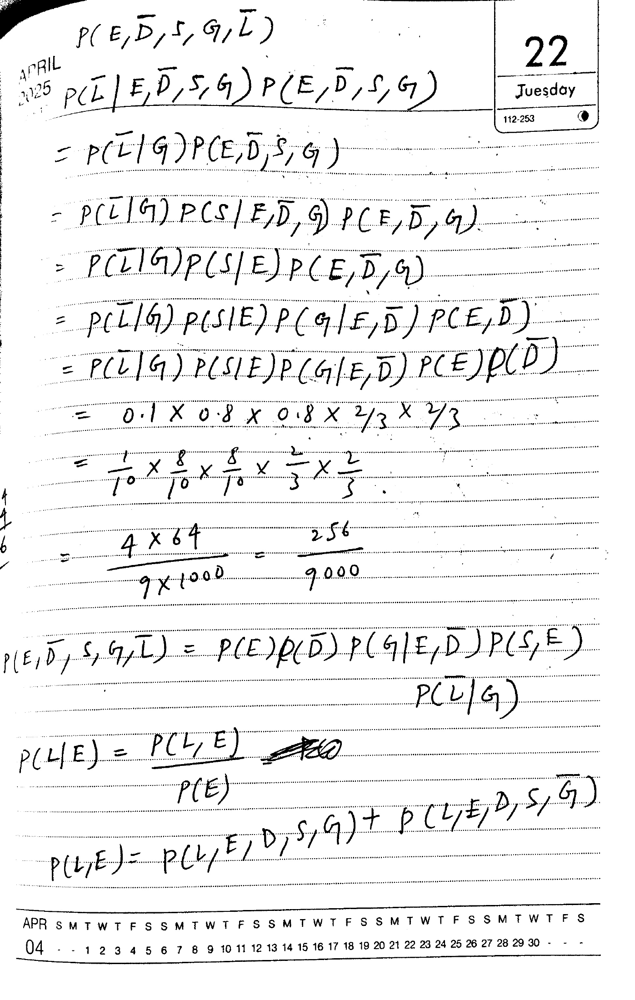
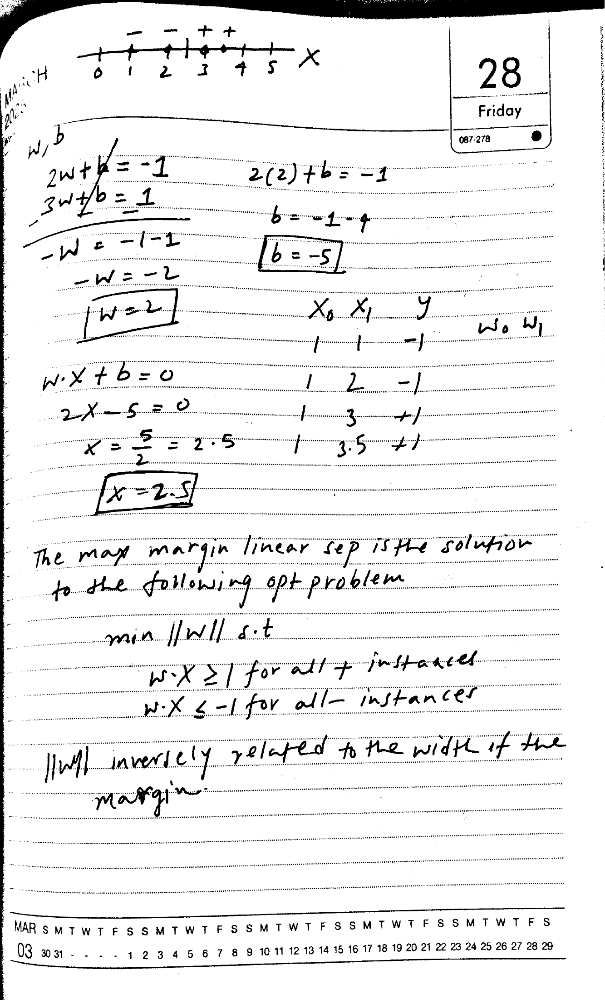
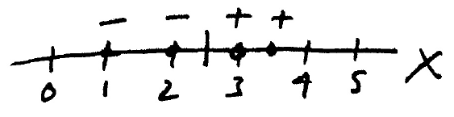
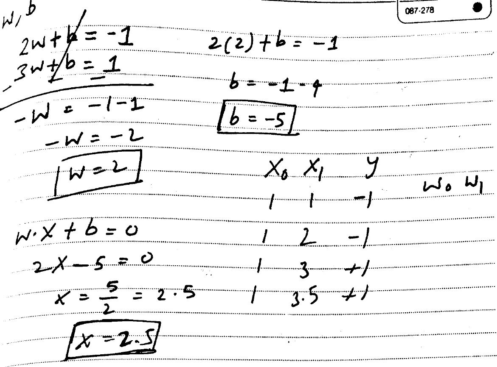
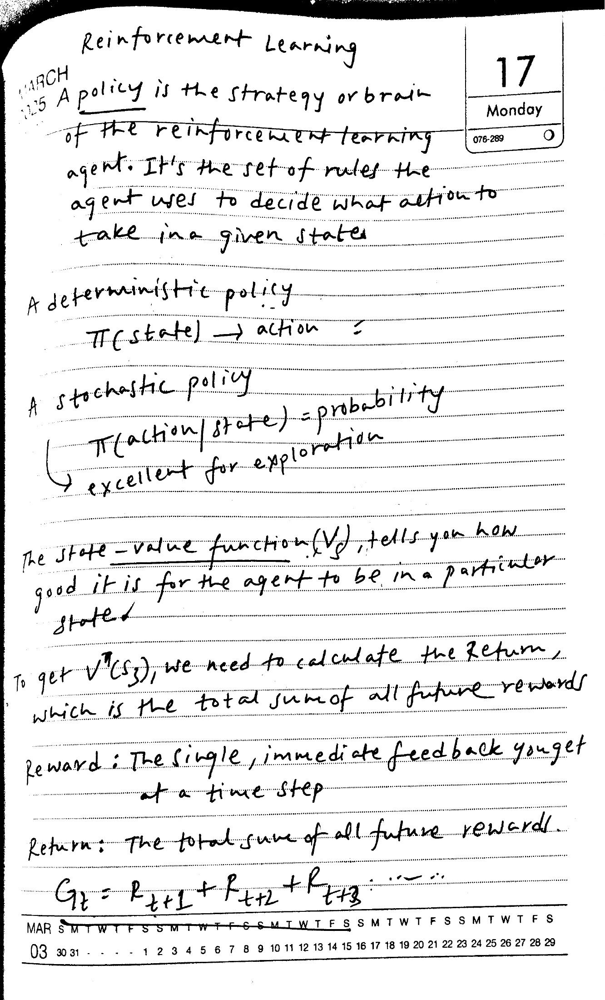
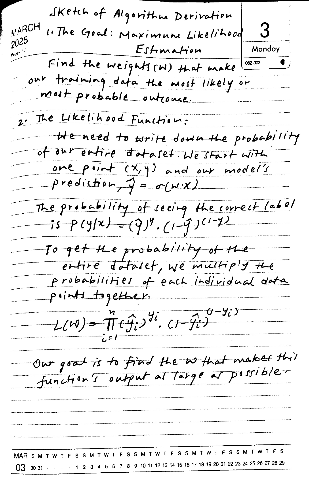
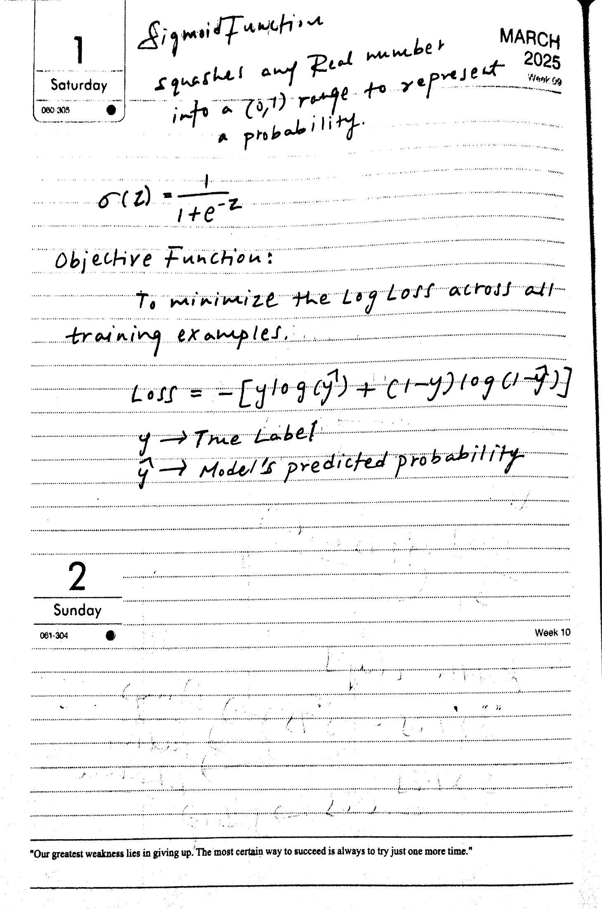

# GLM vs. MiniCPM: Five-Page Recognition and Timing Comparison

[Open the original side-by-side HTML report](fresh-comparison.html) after cloning the repository.

Original, SDK output and GLM output on the same five page images. These are raw model results, not corrected transcriptions. SDK image regions show original crops, not selectable recognized text. Page timings measure different operations and are not a controlled speed comparison.

[View the reviewed references](fresh-reference-review.md)

## handwriting-6-1

### Original

### MiniCPM SDK

9.14 s, process wall time

$P(E, \overline{D}, S, G, \overline{L})$  

$P(\overline{L}|E, \overline{D}, S, G) P(E, \overline{D}, S, G)$  

$= P(\overline{L}|G) P(E, \overline{D}, S, G)$  

$= P(\overline{L}|G) P(S|E, \overline{D}, G) P(E, \overline{D}, G)$  

$= P(\overline{L}|G) P(S|E) P(E, \overline{D}, G)$  

$= P(\overline{L}|G) P(S|E) P(G|E, \overline{D}) P(E, \overline{D})$  

$= P(\overline{L}|G) P(S|E) P(G|E, \overline{D}) P(E) P(\overline{D})$  

$= 0.1 \times 0.8 \times 0.8 \times \frac{2}{3} \times \frac{2}{3}$  

$= \frac{1}{10} \times \frac{8}{10} \times \frac{8}{10} \times \frac{2}{3} \times \frac{2}{3}$  

$= \frac{4 \times 64}{9 \times 1000} = \frac{256}{9000}$  

$P(E, \overline{D}, S, G, \overline{L}) = P(E)P(\overline{D})P(G|E, \overline{D})P(S, E)$  

P (L | E) = \frac{P (L , E)}{P (E)}  

### GLM direct

11.17 s, request time

$P(E, \bar{D}, S, G, \bar{L})$  
$P(\bar{L} | E, \bar{D}, S, G) P(E, \bar{D}, S, G)$  

$= P(\bar{L} | G) P(E, \bar{D}, S, G)$  

$= P(\bar{L} | G) P(S | E, \bar{D}, G) P(E, \bar{D}, G)$  

$= P(\bar{L} | G) P(S | E) P(E, \bar{D}, G)$  

$= P(\bar{L} | G) P(S | E) P(G | E, \bar{D}) P(E, \bar{D})$  

$= P(\bar{L} | G) P(S | E) P(G | E, \bar{D}) P(E) P(\bar{D})$  

$= 0.1 \times 0.8 \times 0.8 \times 2/3 \times 2/3$  

$= \frac{1}{10} \times \frac{8}{10} \times \frac{8}{10} \times \frac{2}{3} \times \frac{2}{3}$  

$= \frac{4 \times 64}{9 \times 1000} = \frac{256}{9000}$  

$P(E, \bar{D}, S, G, \bar{L}) = P(E) P(\bar{D}) P(G | E, \bar{D}) P(S, E)$  

$P(\bar{L} | G)$  

$P(L | E) = \frac{P(L, E)}{P(E)}$  

$P(L, E) = P(L, E, D, S, G) + P(L, E, D, S, \bar{G})$  

## handwriting-6-2

### Original

### MiniCPM SDK

5.31 s, process wall time

MARCH  

2025  

Original image region retained by SDK

Original image region retained by SDK

The max margin linear sep is the solution to the following opt problem  

min ||W|| s.t  

$$
w \cdot x \geq 1 \text{ for all + instances}  
$$

$$
w \cdot x \leq -1 \text{ for all - instances}  
$$

|w| inversely related to the width of the margin.  

### GLM direct

5.11 s, request time

2w + b = -1  
3w + b = 1  
-W = -1 - 1  
-W = -2  
W = 2  

2(2) + b = -1  
b = -1 - 4  
b = -5  

$x_0, x_1, y$  
1 1 -1 $w_0, w_1$  

$w \cdot x + b = 0$  
$2x - 5 = 0$  
$x = \frac{5}{2} = 2.5$  
$x = 2.5$  

The max margin linear sep is the solution to the following opt problem  
min ||w|| s.t.  
$w \cdot x \ge 1$ for all instances  
$w \cdot x \le -1$ for all instances  

||w|| inversely related to the width of the margin.  

## handwriting-6-3

### Original

### MiniCPM SDK

8.36 s, process wall time

Reinforcement Learning  

MARCH  

125 A policy is the strategy or brain  

of the reinforcement learning  

agent. It's the set of rules the  

agent uses to decide what action  

take in a given state  

A deterministic policy  

$\pi(\text{state}) \to \text{action}$  

A stochastic policy  

$\pi(action | state) = probability$  

excellent for exploration  

The state-value function $(V_{s})$, tells you how good it is for the agent to be in a particular state.  

To get $V^{\pi}(s_{3})$, we need to calculate the Return, which is the total sum of all future rewards  

reward : The single, immediate feedback you get at a time step  

Return: The total sum of all future rewards.  

$G_{t} = R_{t+1} + R_{t+2} + R_{t+3}$ ...  

MAR  

### GLM direct

5.10 s, request time

Reinforcement Learning  

A policy is the strategy or brain of the reinforcement learning agent. It's the set of rules the agent uses to decide what action to take in a given state.  

A deterministic policy  

$$
\pi(\text{state}) \rightarrow \text{action}  
$$

A stochastic policy  

$$
\pi(\text{action}|\text{state}) = \text{probability} \text{ excellent for exploration}  
$$

The state-value function $V_s$ tells you how good it is for the agent to be in a particular state.  

To get $V^T(s_3)$, we need to calculate the return, which is the total sum of all future rewards.  

Reward: The single, immediate feedback you get at a time step  

Return: The total sum of all future rewards.  

$$
G_t = R_{t+1} + R_{t+2} + R_{t+3}  
$$

## handwriting-7-1

### Original

### MiniCPM SDK

8.68 s, process wall time

Sketch of Algorithm Derivation  

1. The Goal: Maximum Likelihood Estimation  

Monday  

Find the weights (w) that make our training data the most likely or most probable outcome.  

2. The Likelihood Function:  

We need to write down the probability of our entire dataset. We start with one point $(x, y)$ and our model's prediction, $\hat{y} = \sigma(w \cdot x)$  

The probability of seeing the correct label is $p(y|x) = (\hat{y})^{y} \cdot (1 - \hat{y})^{(1 - y)}$  

To get the probability of the entire dataset, we multiply the probabilities of each individual data points together.  

$$
L(w)=\prod_{i=1}^{n}(\hat{y}_{i})^{y_{i}}.(1-\hat{y}_{i})^{(1-y_{i})}  
$$

Our goal is to find the w that makes this function's output as large as possible.  

### GLM direct

9.41 s, request time

Sketch of Algorithm Derivation  
1. The Goal: Maximum Likelihood Estimation  

Find the weights $w$ that make our training data the most likely or most probable outcome.  

2. The Likelihood Function:  

We need to write down the probability of our entire dataset. We start with one point $(x, y)$ and our model's prediction, $\hat{y} = \sigma(w \cdot x)$  

The probability of seeing the correct label is $P(y|x) = (\hat{y})^y \cdot (1 - \hat{y})^{1-y}$  

To get the probability of the entire dataset, we multiply the probabilities of each individual data points together.  

$$
L(w) = \prod_{i=1}^{n} (\hat{y}_i)^y \cdot (1 - \hat{y}_i)^{1-y}  
$$

Our goal is to find the $w$ that makes this function's output as large as possible.  

## handwriting-7-2

### Original

### MiniCPM SDK

5.87 s, process wall time

Sigmoid function MARCH  

squashes any Real number 2025  

into a (0,1) range to represent Week 59  

a probability.  

$$
\sigma(z)=\frac{1}{1+e^{-z}}  
$$

Objective Function:  

To minimize the Log Loss across all training examples.  

$$
\begin{array}{l} \text{Loss} = - [ y \log (\hat{y}) + (1 - y) \log (1 - \hat{y}) ] \\ y \to \text{True Label} \\ \hat{y} \to \text{Model's predicted probability} \end{array}  
$$

2  

Sunday  

"Our greatest weakness lies in giving up. The most certain way to succeed is always to try just one more time."  

### GLM direct

9.67 s, request time

Sigmoid Function  
squashes any Real number  
into a (0,1) range to represent  
a probability.  

$$
\sigma(z) = \frac{1}{1 + e^{-z}}  
$$

Objective Function:  
To minimize the Log Loss across all  
training examples.  

$$
\text{Loss} = -[y \log(y^2) + (1-y) \log(1-y)]  
$$

$$
y \rightarrow \text{True Label}  
$$

$$
\hat{y} \rightarrow \text{Model's predicted probability}  
$$

2  
Sunday  
061-304  

"Our greatest weakness lies in giving up. The most certain way to succeed is always to try just one more time."
