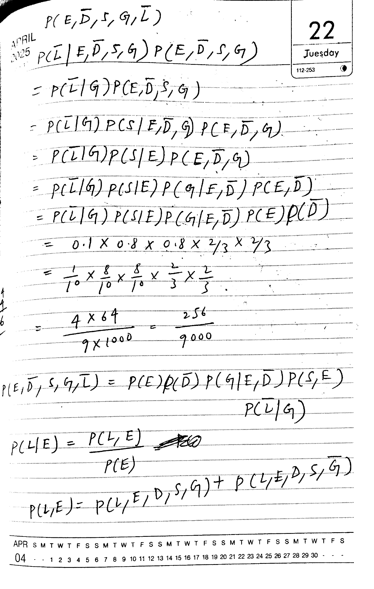
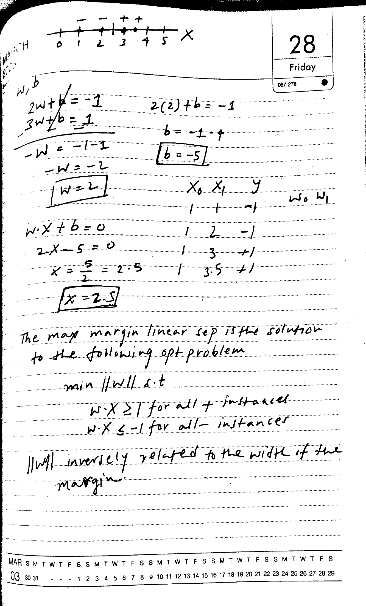
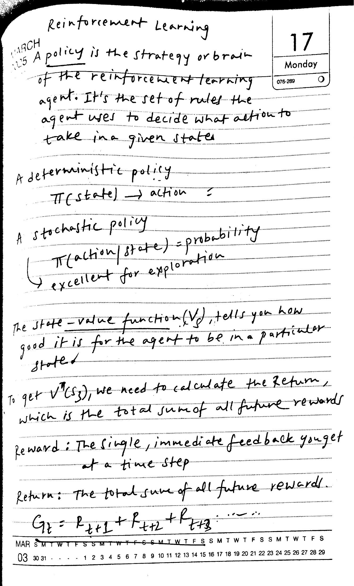
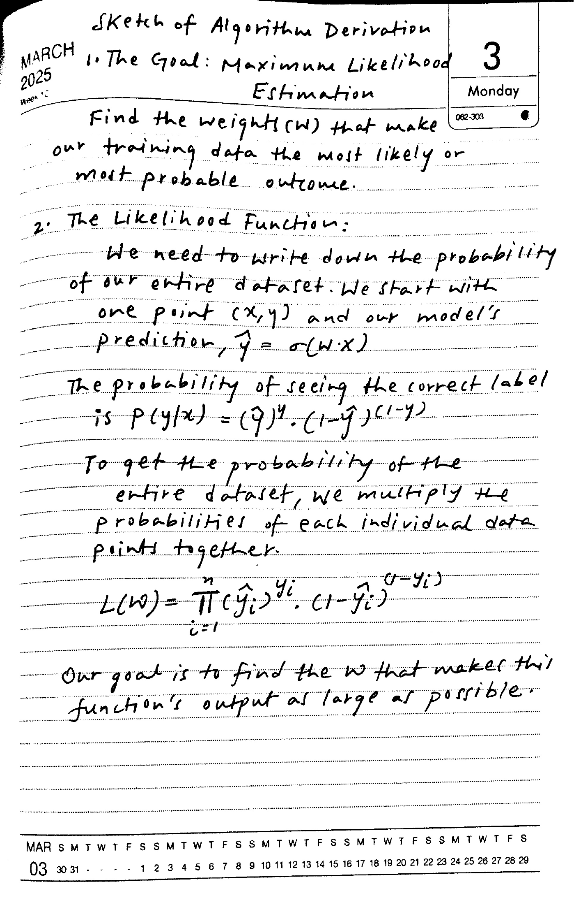
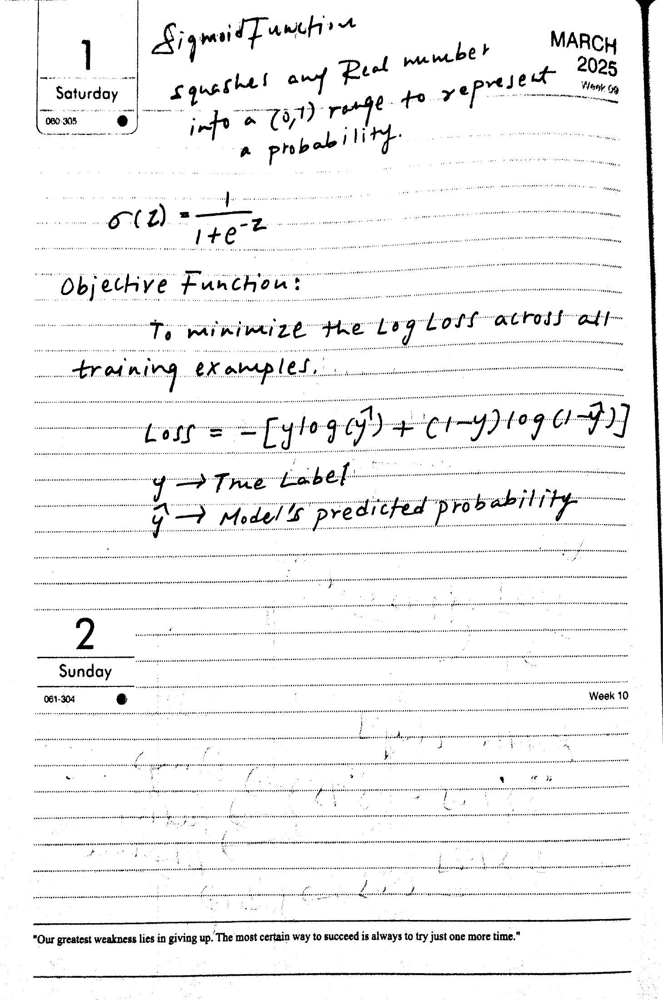

# Author-reviewed references

[Open the original side-by-side HTML report](fresh-reference-review.html) after cloning the repository.

The author reviewed these transcriptions. Printed planner material is omitted. Diagram descriptions are not transcriptions of diagram pixels.

[Open model outputs after reviewing](fresh-comparison.html)

## handwriting-6-1

### Original

### Reference

Reference — reviewed by the author. Printed planner material is excluded. Preserve handwritten symbols; do not fix mathematical reasoning.  

$P(E,\bar D,S,G,\bar L)$  

$P(\bar L\mid E,\bar D,S,G)P(E,\bar D,S,G)$  

$=P(\bar L\mid G)P(E,\bar D,S,G)$  

$=P(\bar L\mid G)P(S\mid E,\bar D,G)P(E,\bar D,G)$  

$=P(\bar L\mid G)P(S\mid E)P(E,\bar D,G)$  

$=P(\bar L\mid G)P(S\mid E)P(G\mid E,\bar D)P(E,\bar D)$  

$=P(\bar L\mid G)P(S\mid E)P(G\mid E,\bar D)P(E)P(\bar D)$  

$=0.1\times0.8\times0.8\times\frac23\times\frac23$  

$=\frac1{10}\times\frac8{10}\times\frac8{10}\times\frac23\times\frac23$  

$=\frac{4\times64}{9\times1000}=\frac{256}{9000}$  

$P(E,\bar D,S,G,\bar L)=P(E)P(\bar D)P(G\mid E,\bar D)P(S,E)P(\bar L\mid G)$  

$P(L\mid E)=\frac{P(L,E)}{P(E)}$ [crossed-out text omitted]  

$P(L,E)=P(L,E,D,S,G)+P(L,E,D,S,\bar G)$  

## handwriting-6-2

### Original

### Reference

Reference — reviewed by the author. Printed planner material is excluded.  

[Diagram: x number line with labeled ticks 0 to 5; negative points at 1 and 2, positive points at 3 and 3.5; marks indicate a dividing point near 2.5.]  

w, b  

$2w+b=-1$  
$3w+b=1$  
$-w=-1-1$  
$-w=-2$  
$w=2$  

$2(2)+b=-1$  
$b=-1-4$  
$b=-5$  

$w\cdot x+b=0$  
$2x-5=0$  
$x=\frac52=2.5$  
$x=2.5$  

[Table: columns $x_0,x_1,y$; rows 1,1,-1; 1,2,-1; 1,3,+1; 1,3.5,+1. Handwritten $w_0,w_1$ beside the table.]  

The max margin linear sep is the solution to the following opt problem  

$\min \lVert w\rVert$ s.t.  
$w\cdot x\geq1$ for all + instances  
$w\cdot x\leq-1$ for all − instances  

$\lVert w\rVert$ inversely related to the width of the margin.  

## handwriting-6-3

### Original

### Reference

Reference — reviewed by the author. Printed planner material is excluded.  

Reinforcement Learning  

A policy is the strategy or brain of the reinforcement learning agent. It's the set of rules the agent uses to decide what action to take in a given state.  

A deterministic policy  
$\pi(\mathrm{state})\rightarrow\mathrm{action}$  

A stochastic policy  
$\pi(\mathrm{action}\mid\mathrm{state})=\mathrm{probability}$  
→ excellent for exploration  

The state-value function $(V_s)$, tells you how good it is for the agent to be in a particular state.  

To get $V^\pi(s_3)$, we need to calculate the Return, which is the total sum of all future rewards.  

Reward: The single, immediate feedback you get at a time step  

Return: The total sum of all future rewards  

$G_t=R_{t+1}+R_{t+2}+R_{t+3}+\cdots$  

## handwriting-7-1

### Original

### Reference

Reference — reviewed by the author. Printed planner material is excluded.  

Sketch of Algorithm Derivation  

1. The Goal: Maximum Likelihood Estimation  

Find the weights (w) that make our training data the most likely or most probable outcome.  

2. The Likelihood Function:  

We need to write down the probability of our entire dataset. We start with one point (x,y) and our model's prediction, $\hat y=\sigma(w\cdot x)$  

The probability of seeing the correct label is $P(y\mid x)=(\hat y)^y\cdot(1-\hat y)^{(1-y)}$  

To get the probability of the entire dataset, we multiply the probabilities of each individual data point together.  

$L(w)=\prod_{i=1}^{n}(\hat y_i)^{y_i}\cdot(1-\hat y_i)^{(1-y_i)}$  

Our goal is to find the w that makes this function's output as large as possible.  

## handwriting-7-2

### Original

### Reference

Reference — reviewed by the author. Printed planner material is excluded.  

Sigmoid Function  

squashes any Real number into a (0,1) range to represent a probability.  

$\sigma(z)=\frac{1}{1+e^{-z}}$  

Objective Function:  

To minimize the Log Loss across all training examples.  

$\mathrm{Loss}=-[y\log(\hat y)+(1-y)\log(1-\hat y)]$  

$y$ → True Label  

$\hat y$ → Model's predicted probability
