# GLM and MiniCPM Page Recognition with Qwen Formula Detection

[Open the original side-by-side HTML report](workflow-report.html) after cloning the repository.

MiniCPM SDK uses PP-DocLayoutV3 torch on CPU with orientation correction disabled and MiniCPM OCR through a local server. GLM reads each full page directly. Qwen proposals are formula-only, not a complete page pipeline. The eleven standalone-formula references are provisional and inline notation is not exhaustively labeled. All output is uncorrected.

## handwriting-4-1

### Original page

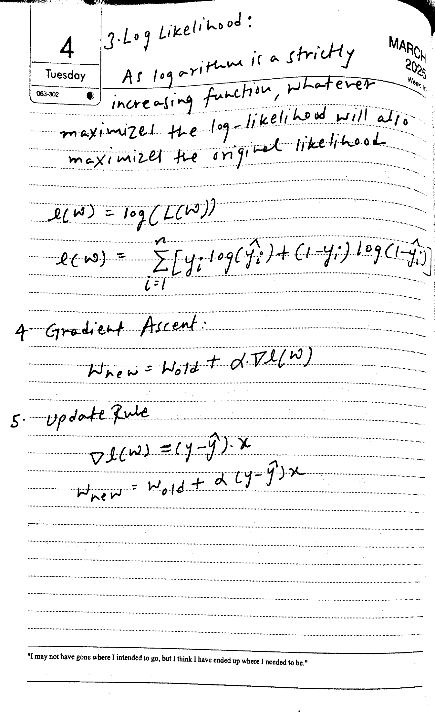

### MiniCPM SDK assembled Markdown

Tuesday  

3. Log Likelihood:  

As logarithm is a strictly  

increasing function, whatever  

maximizes the log-likelihood will also  

maximize the original likelihood  

$$
\begin{array}{l} l (w) = \log (L (w)) \\ l (w) = \sum_{i = 1}^{n} [ y_{i} \log (\hat{y}_{i}) + (1 - y_{i}) \log (1 - \hat{y}_{i}) ] \\ \end{array}  
$$

Gradient Ascent:  

$$
w_{new} = w_{old} + \alpha \nabla l(w)  
$$

5. Update Rule  

$$
\begin{array}{l} \Delta l (w) = (y - \hat{y}) \cdot x \\ w_{new} = w_{old} + \alpha (y - \hat{y}) x \end{array}  
$$

### GLM direct whole-page output

3. Log Likelihood:  
As logarithm is a strictly increasing function, whatever maximizes the log-likelihood will also maximize the original likelihood  

$$
e(W) = \log(L(W))  
$$

$$
e(W) = \sum_{i=1}^{n} [y_i \log(\hat{y}_i) + (1-y_i) \log(1-\hat{y}_i)]  
$$

4. Gradient Ascent:  

$$
W_{\text{new}} = W_{\text{old}} + \alpha \nabla e(W)  
$$

5. Update Rule  

$$
\nabla e(W) = (y - \hat{y}) \cdot x  
$$

$$
W_{\text{new}} = W_{\text{old}} + \alpha (y - \hat{y}) x  
$$

"I may not have gone where I intended to go, but I think I have ended up where I needed to be."  

Qwen 4B proposals + MiniCPM recognition (5)

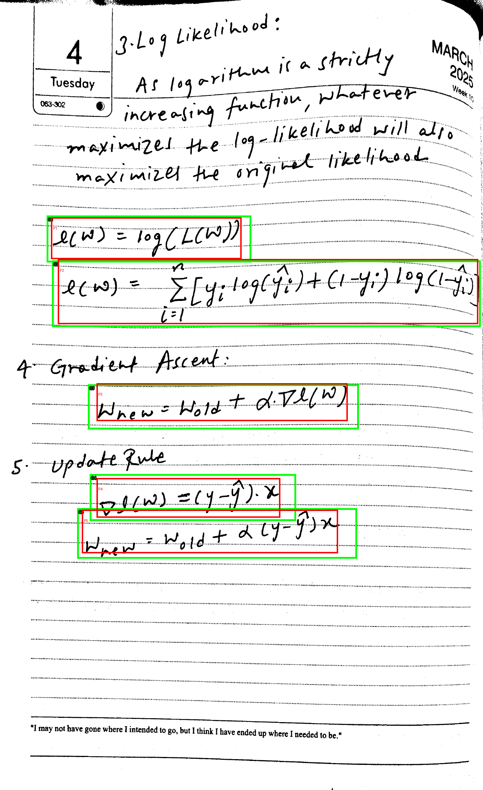

#### Proposal 1

Overlaps provisional reference 4a-log (IoU 0.835); does not guarantee a complete crop.

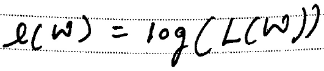

Draft reference: \(\ell(w)=\log(L(w))\)

$$
e(w)=\log(L(w))  
$$

#### Proposal 2

Overlaps provisional reference 4a-sum (IoU 0.922); does not guarantee a complete crop.

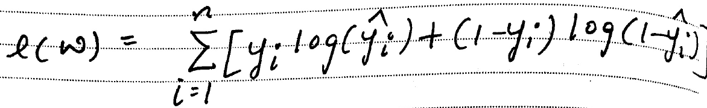

Draft reference: \(\ell(w)=\sum_{i=1}^{n}[y_i\log(\hat{y}_i)+(1-y_i)\log(1-\hat{y}_i)]\)

$$
l (w) = \sum_{i = 1}^{n} [ y_{i} \log (\hat{y}_{i}) + (1 - y_{i}) \log (1 - \hat{y}_{i}) ]  
$$

#### Proposal 3

Overlaps provisional reference 4a-ascent (IoU 0.745); does not guarantee a complete crop.

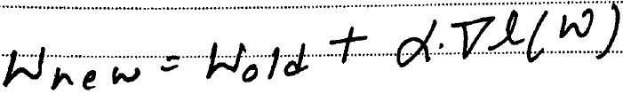

Draft reference: \(w_{new}=w_{old}+\alpha\cdot\nabla\ell(w)\)

$$
W_{new}=W_{old}+\alpha.\nabla l(W)  
$$

#### Proposal 4

Overlaps provisional reference 4a-gradient (IoU 0.753); does not guarantee a complete crop.

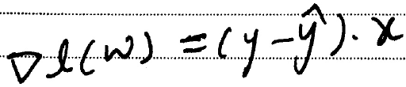

Draft reference: \(\nabla\ell(w)=(y-\hat{y})\cdot x\)

$$
\Delta l ( \omega ) = ( y - \hat{y} ) \cdot x  
$$

#### Proposal 5

Overlaps provisional reference 4a-update (IoU 0.791); does not guarantee a complete crop.

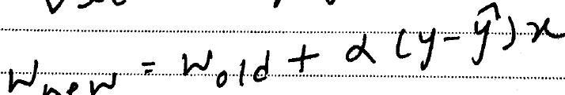

Draft reference: \(w_{new}=w_{old}+\alpha(y-\hat{y})x\)

$$
w_{new}=w_{old}+\alpha(y-\hat{y})x  
$$

## handwriting-4-2

### Original page

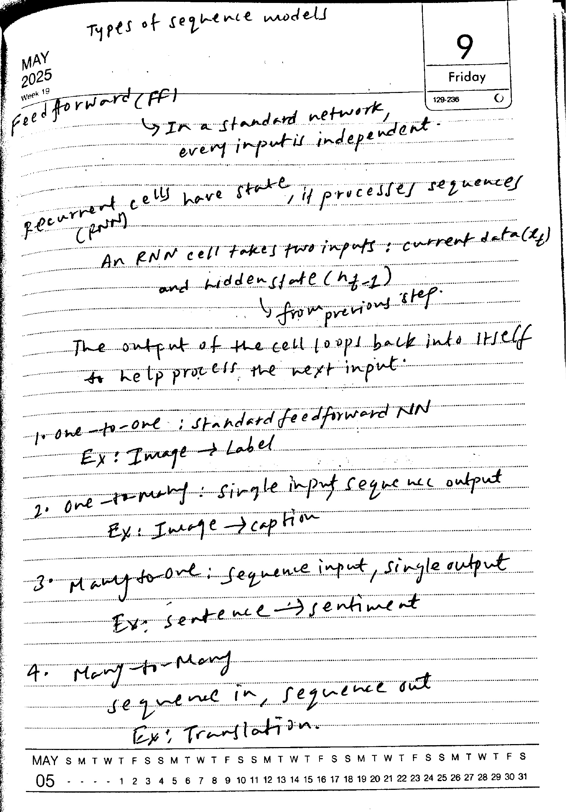

### MiniCPM SDK assembled Markdown

Feed forward (FF) In a standard network, every input is independent.  

Recurrent cells have state, if processes sequences (PNN)  

cells take two inputs: current data(  

An RNN cell takes two inputs: current data ($x_t$) and hidden state ($h_{t-1}$) from previous step.  

The output of the cell loops back into itself to help process the next input.  

1. one-to-one : standard feedforward NN  

Ex: Image → Label  

2. one-to-many : single input sequence output  

Ex: Image → caption  

3. Many-to-one: sequence input, single output  

Ex: sentence → sentiment  

4. Many to Many  

sequence in, sequence out  

Ex: Translation.  

MAY  

### GLM direct whole-page output

Types of sequence models  

May 2025  
Week 19  

Feedforward (FF)  

In a standard network, every input is independent.  

Recurrent cells have state, it processes sequences (RNN)  

An RNN cell takes two inputs: current data ($k$) and hidden state ($h_{f-1}$)  

from previous step.  

The output of the cell loops back into itself to help process the next input.  

1. One-to-one; standard feedforward NN  
   Ex: Image → Label  

2. One-to-many: single input sequence output  
   Ex: Image → caption  

3. Many-to-one: sequence input, single output  
   Ex: sentence → sentiment  

4. Many-to-Many  
   sequence in, sequence out  
   Ex: Translation.  

Qwen 4B proposals + MiniCPM recognition (3)

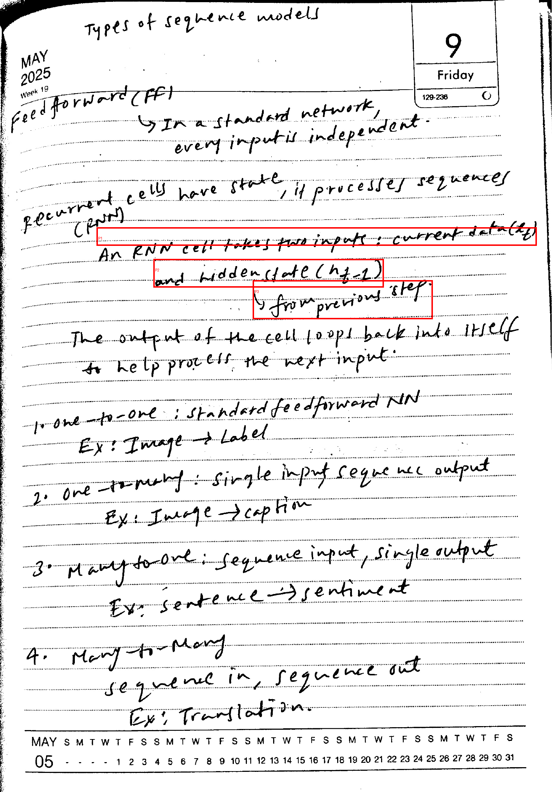

#### Proposal 1

No match in the standalone-only reference set; this may contain other notation or text.

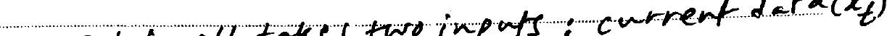

$$
\text{two inputs: current data}(x_t)  
$$

#### Proposal 2

No match in the standalone-only reference set; this may contain other notation or text.

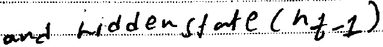

$$
\text{andhiddenstate}(n_{t}-1)  
$$

#### Proposal 3

No match in the standalone-only reference set; this may contain other notation or text.

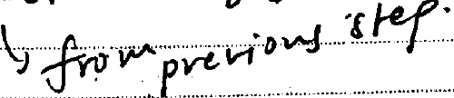

$$
\text{from previous step.}  
$$

## handwriting-5-1

### Original page

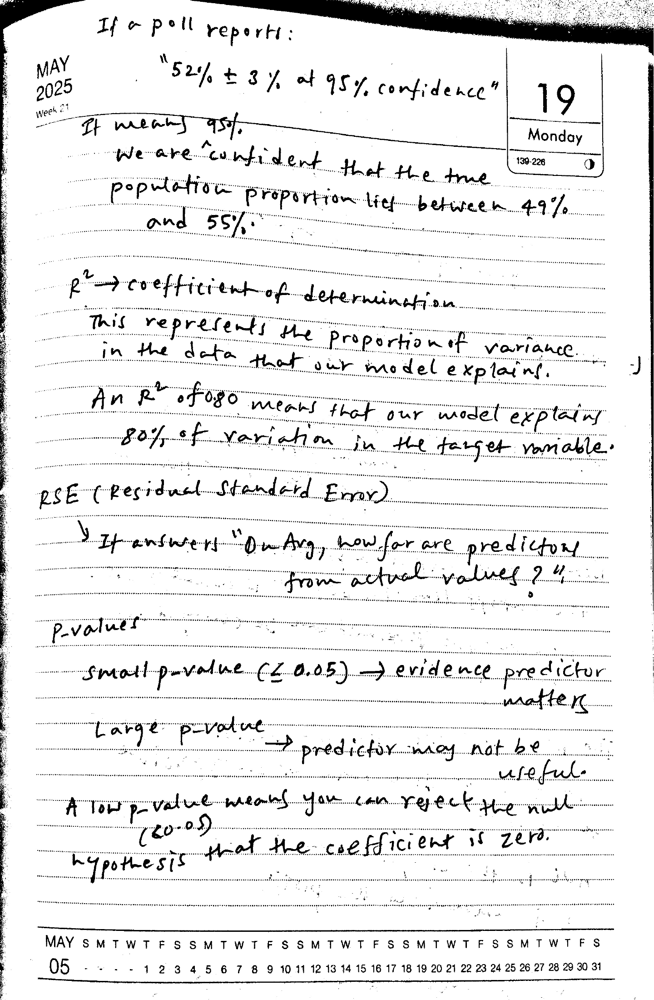

### MiniCPM SDK assembled Markdown

If a poll reports:  

"52% ± 3% at 95% confidence"  

It means 95%.  

We are confident that the true population proportion lies between 49% and 55%.  

Monday  

139-226  

$r^{2}$ → coefficient of determination  

This represents the proportion of variance in the data that our model explains.  

An $R^{2}$ of 0.80 means that our model explains 80% of variation in the target variable.  

RSE (Residual Standard Error)  

If answers "On Avg, how far are predictor/  

from actual values?"  

p-values  

small p-value ( $\leq 0.05$ ) $\rightarrow$ evidence predictor matters  

Large p-value $\rightarrow$ predictor may not be useful.  

A low p-value means you can reject the null (60.05) hypothesis that the coefficient is zero.  

### GLM direct whole-page output

If a poll reports:  
"52% ± 3% at 95% confidence"  

It means 95%.  
We are confident that the true population proportion lies between 49% and 55%.  

$R^2 \rightarrow$ coefficient of determination.  
This represents the proportion of variance in the data that our model explains.  

An $R^2$ of 0.80 means that our model explains 80% of variation in the target variable.  

RSE (Residual Standard Error)  
It answers "On Arg, how far are predictors from actual values?"  

P-values  
Small $p$-value ($\leq 0.05$) $\rightarrow$ evidence predictor matters  
Large $p$-value $\rightarrow$ predictor may not be useful.  

A low $p$-value means you can reject the null hypothesis that the coefficient is zero.  

Qwen 4B proposals + MiniCPM recognition (7)

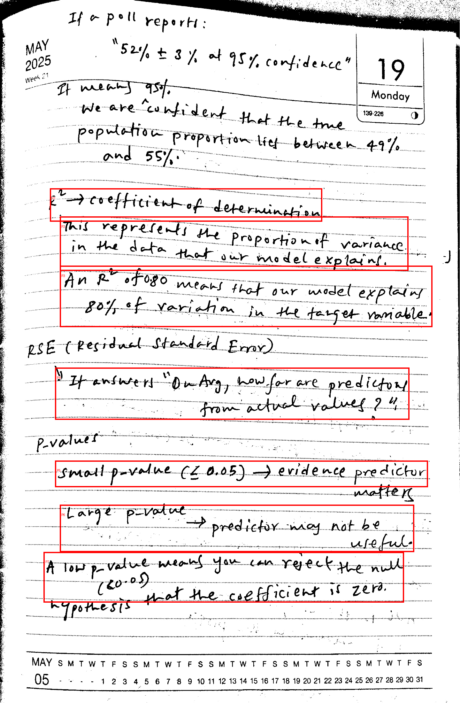

#### Proposal 1

No match in the standalone-only reference set; this may contain other notation or text.

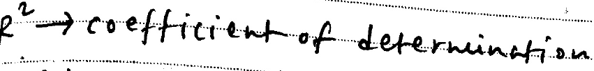

$$
r^{2}\rightarrow\text{coefficientofdetermination}  
$$

#### Proposal 2

No match in the standalone-only reference set; this may contain other notation or text.

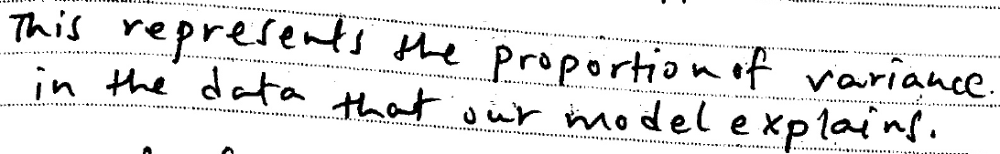

$$
\begin{array}{l} \text{This represents the proportion of variance.} \\ \text{in the data that our model explains.} \end{array}  
$$

#### Proposal 3

No match in the standalone-only reference set; this may contain other notation or text.

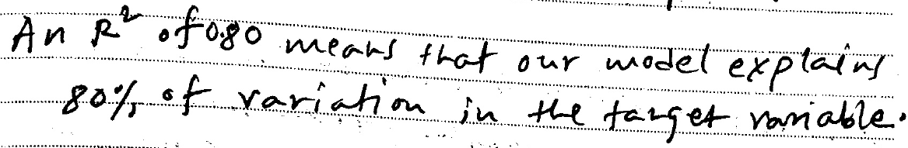

$$
\begin{array}{l} \text{An } R^2 \text{ of 0.80 means that our model explains} \\ \text{80\% of variation in the target variable.} \end{array}  
$$

#### Proposal 4

No match in the standalone-only reference set; this may contain other notation or text.

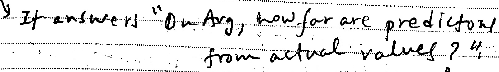

$$
\begin{array}{l} \text{It answers "On Avg, how far are prediction}\\ \text{from actual values?"} \end{array}  
$$

#### Proposal 5

No match in the standalone-only reference set; this may contain other notation or text.

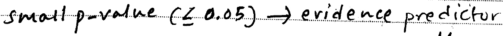

$$
\text{small } p \text{-value} (\leq 0.05) \to \text{evidence predictor}  
$$

#### Proposal 6

No match in the standalone-only reference set; this may contain other notation or text.

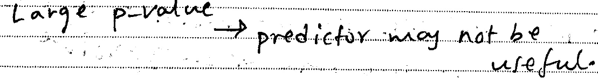

$$
\text{Largep-value}\rightarrow\text{predictormaynotbeuseful.}  
$$

#### Proposal 7

No match in the standalone-only reference set; this may contain other notation or text.

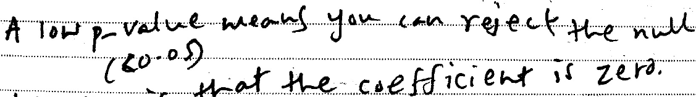

$$
\begin{array}{l} \text{A low p-value means you can reject the null} \\ (80.05) \\ \text{that the coefficient is zero.} \end{array}  
$$

## handwriting-5-2

### Original page

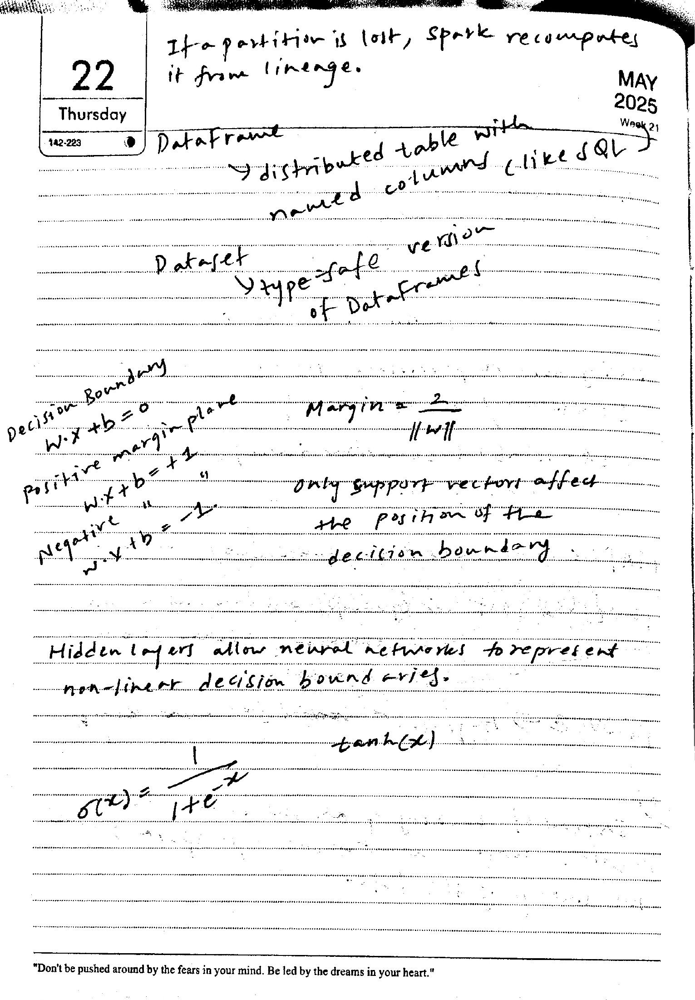

### MiniCPM SDK assembled Markdown

22  

Thursday  

If a partition is lost, spark recomputes  

it from lineage.  

Dataframe  

→ distributed table with  

named columns (like SQL)  

Dataset  

Ytype=safe version  

of Dataframes  

Decision Boundary  

$w \cdot x + b = 0$  

Positive margin plane  

$w \cdot x + b = +1$  

“  

Negative  

$w \cdot x + b = -1$.  

only support vectors affect  

the position of the  

decision boundary.  

Hidden layers allow neural networks to represent non-linear decision bound aries.  

tanh(x)  

$$
\sigma (x) = \frac{1}{1 + e^{- x}}  
$$

### GLM direct whole-page output

If a partition is lost, spark recomputes it from lineage.  

DataFrame  
distributed table with named columns like SQL  

Dataset  
type-safe version of DataFrames  

Decision Boundary  
$w \cdot x + b = 0$  
positive margin plane  
$w \cdot x + b = +1$  
negative  
$w \cdot x + b = -1$  

Margin = $\frac{2}{||w||}$  

only support vectors affect the position of the decision boundary.  

Hidden layers allow neural networks to represent non-linear decision boundaries.  

$\sigma(x) = \frac{1}{1 + e^{-x}}$  

"Don't be pushed around by the fears in your mind. Be led by the dreams in your heart."  

Qwen 4B proposals + MiniCPM recognition (10)

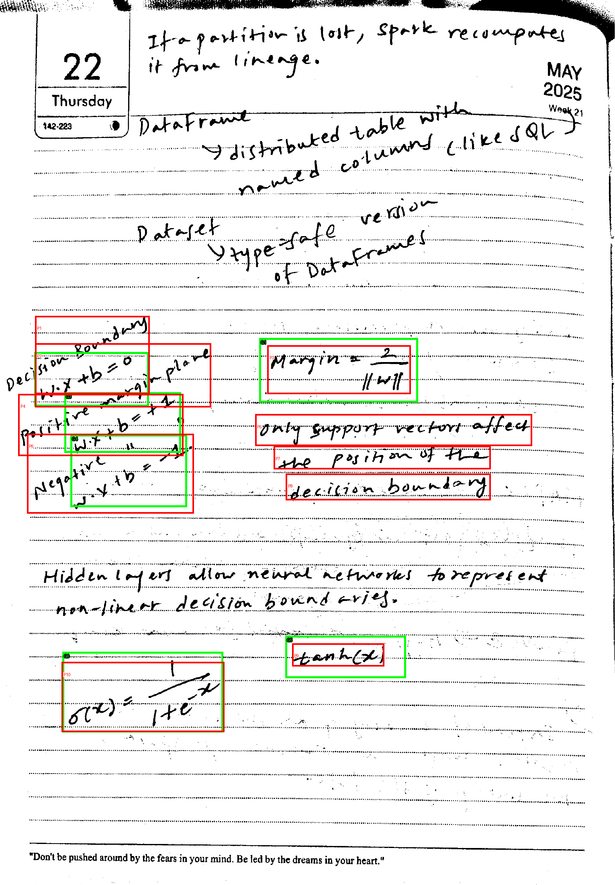

#### Proposal 1

No match in the standalone-only reference set; this may contain other notation or text.

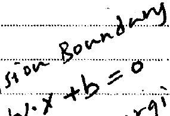

$$
x + b = 0  
$$

#### Proposal 2

Overlaps provisional reference 5b-boundary (IoU 0.548); does not guarantee a complete crop.

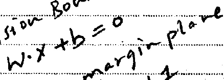

Draft reference: \(w\cdot x+b=0\)

$$
w \cdot x + b = 0  
$$

#### Proposal 3

Overlaps provisional reference 5b-margin (IoU 0.683); does not guarantee a complete crop.

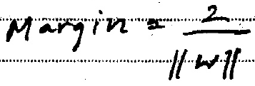

Draft reference: \(\text{Margin}=\frac{2}{\lVert w\rVert}\)

$$
\text{Margin}=\frac{2}{||w||}  
$$

#### Proposal 4

Overlaps provisional reference 5b-positive (IoU 0.658); does not guarantee a complete crop.

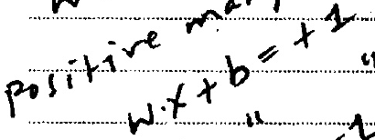

Draft reference: \(w\cdot x+b=+1\)

$$
\text{positive many}\\ w \cdot x + b = + 2  
$$

#### Proposal 5

No match in the standalone-only reference set; this may contain other notation or text.

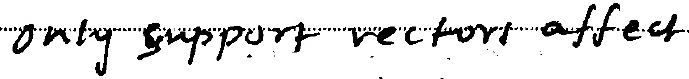

$$
\text{onlysupportvectorsaffected}  
$$

#### Proposal 6

Overlaps provisional reference 5b-negative (IoU 0.635); does not guarantee a complete crop.

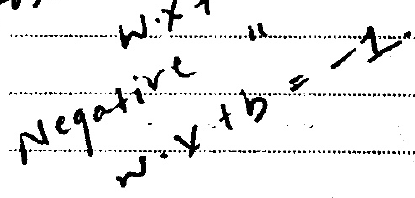

Draft reference: \(w\cdot x+b=-1\)

$$
\text{Negative} " w \cdot x + b = -1.  
$$

#### Proposal 7

No match in the standalone-only reference set; this may contain other notation or text.

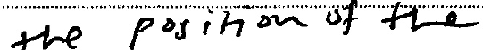

$$
\text{thepositionofthe}  
$$

#### Proposal 8

No match in the standalone-only reference set; this may contain other notation or text.

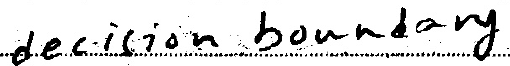

$$
\text{decisionboundary}  
$$

#### Proposal 9

Overlaps provisional reference 5b-tanh (IoU 0.417); does not guarantee a complete crop.

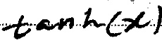

Draft reference: \(\tanh(x)\)

$$
tanh(x)  
$$

#### Proposal 10

Overlaps provisional reference 5b-sigmoid (IoU 0.858); does not guarantee a complete crop.

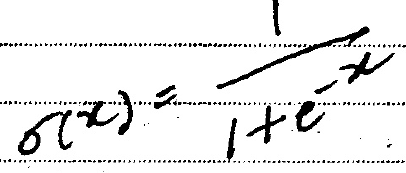

Draft reference: \(\sigma(x)=\frac{1}{1+e^{-x}}\)

$$
\sigma (x) = \frac{1}{1 + e^{- x}}  
$$

