# GLM page-resolution comparison

[Open the original side-by-side HTML report](index.html) after cloning the repository.

Handwritten page images and transcriptions are included in this report. Each request used a fresh process. 1100 px images were downsampled from 2200 px PDFKit images. CER is case-sensitive; LaTeX representation, included planner text, and diagram descriptions can inflate it. The repetition warning catches only some cases. Some references were prepared after earlier model output was seen.

## diagram-handwriting-1

### Original page

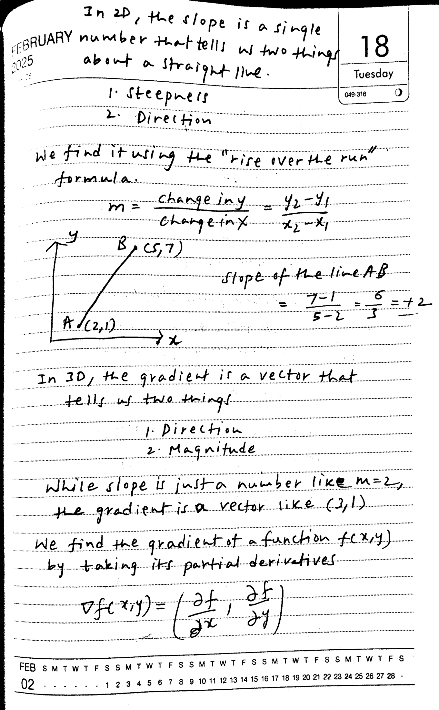

### Reference

In 2D, the slope is a single  
number that tells us two things  
about a straight line.  
1. Steepness  
2. Direction  
We find it using the "rise over the run"  
formula.  
m = change in y / change in x = (y2 - y1) / (x2 - x1)  
y  
B (5,7)  
A (2,1)  
x  
Slope of the line AB  
= (7-1) / (5-2) = 6 / 3 = +2  
In 3D, the gradient is a vector that  
tells us two things  
1. Direction  
2. Magnitude  
While slope is just a number like m=2,  
the gradient is a vector like (3,1)  
We find the gradient of a function f(x,y)  
by taking its partial derivatives  
∇f(x,y) = (∂f/∂x, ∂f/∂y)  

Raw text and LaTeX

In 2D, the slope is a single  
number that tells us two things  
about a straight line.  
1. Steepness  
2. Direction  
We find it using the "rise over the run"  
formula.  
m = change in y / change in x = (y2 - y1) / (x2 - x1)  
y  
B (5,7)  
A (2,1)  
x  
Slope of the line AB  
= (7-1) / (5-2) = 6 / 3 = +2  
In 3D, the gradient is a vector that  
tells us two things  
1. Direction  
2. Magnitude  
While slope is just a number like m=2,  
the gradient is a vector like (3,1)  
We find the gradient of a function f(x,y)  
by taking its partial derivatives  
∇f(x,y) = (∂f/∂x, ∂f/∂y)  

### 2200 px — 4.72 s; CER 46.3%

In 2D, the slope is a single number that tells us two things about a straight line.  

1. Steepness  
2. Direction  

We find it using the "rise over the run" formula.  

$$
m = \frac{\text{change in } y}{\text{change in } x} = \frac{y_2 - y_1}{x_2 - x_1}  
$$

Slope of the line AB  

$$
= \frac{7-1}{5-2} = \frac{6}{3} = +2  
$$

In 3D, the gradient is a vector that by taking its partial derivatives  

$$
\nabla f(x,y) = \left( \frac{\partial f}{\partial x}, \frac{\partial f}{\partial y} \right)  
$$

Raw text and LaTeX

In 2D, the slope is a single number that tells us two things about a straight line.  

1. Steepness  
2. Direction  

We find it using the "rise over the run" formula.  

$$
m = \frac{\text{change in } y}{\text{change in } x} = \frac{y_2 - y_1}{x_2 - x_1}  
$$

Slope of the line AB  

$$
= \frac{7-1}{5-2} = \frac{6}{3} = +2  
$$

In 3D, the gradient is a vector that by taking its partial derivatives  

$$
\nabla f(x,y) = \left( \frac{\partial f}{\partial x}, \frac{\partial f}{\partial y} \right)  
$$

### 1100 px — 3.25 s; CER 30.3%

In 2D, the slope is a single number that tells us two things about a straight line.  

1. Steepness  
2. Direction  

We find it using the "rise over the run" formula:  

$$
m = \frac{\text{change in y}}{\text{change in x}} = \frac{y_2 - y_1}{x_2 - x_1}  
$$

Slope of the line AB  

$$
= \frac{7-1}{5-2} = \frac{6}{3} = +2  
$$

In 3D, the gradient is a vector that tells us two things  
1. Direction  
2. Magnitude  

While slope is just a number like $m=2$, the gradient is a vector like $(2,1)$  

We find the gradient of a function $f(x,y)$ by taking its partial derivatives  

$$
\nabla f(x,y) = \left( \frac{\partial f}{\partial x}, \frac{\partial f}{\partial y} \right)  
$$

Raw text and LaTeX

In 2D, the slope is a single number that tells us two things about a straight line.  

1. Steepness  
2. Direction  

We find it using the "rise over the run" formula:  

$$
m = \frac{\text{change in y}}{\text{change in x}} = \frac{y_2 - y_1}{x_2 - x_1}  
$$

Slope of the line AB  

$$
= \frac{7-1}{5-2} = \frac{6}{3} = +2  
$$

In 3D, the gradient is a vector that tells us two things  
1. Direction  
2. Magnitude  

While slope is just a number like $m=2$, the gradient is a vector like $(2,1)$  

We find the gradient of a function $f(x,y)$ by taking its partial derivatives  

$$
\nabla f(x,y) = \left( \frac{\partial f}{\partial x}, \frac{\partial f}{\partial y} \right)  
$$

## handwriting-4-1

### Original page

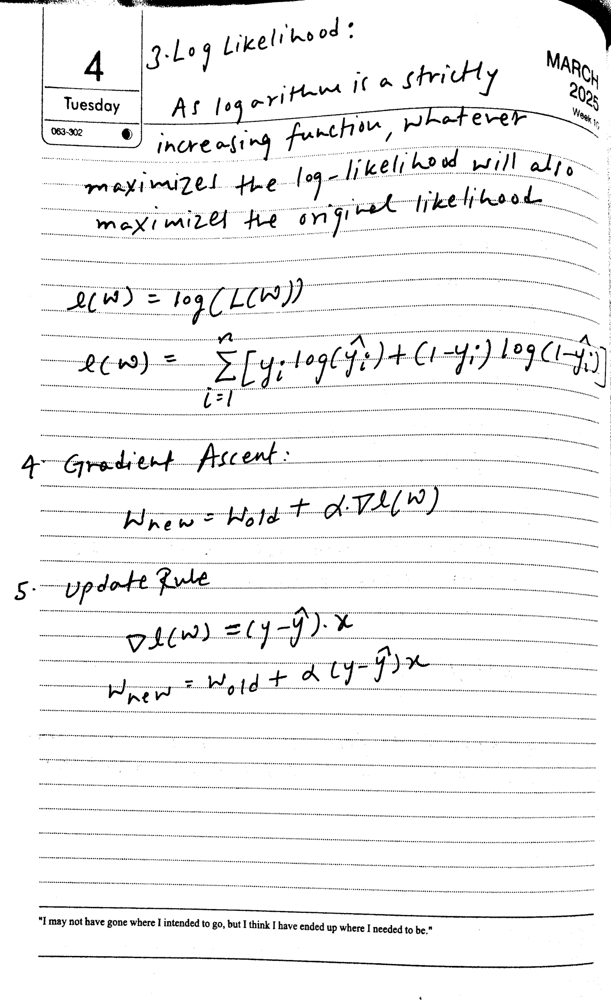

### Reference

3. Log Likelihood:  
As logarithm is a strictly increasing function, whatever maximizes the log-likelihood will also maximize the original likelihood.  

$\ell(w)=\log(L(w))$  
$\ell(w)=\sum_{i=1}^{n}[y_i\log(\hat y_i)+(1-y_i)\log(1-\hat y_i)]$  

4. Gradient Ascent:  
$w_{new}=w_{old}+\alpha\nabla\ell(w)$  

5. Update Rule  
$\nabla\ell(w)=(y-\hat y)\cdot x$  
$w_{new}=w_{old}+\alpha(y-\hat y)x$  

Raw text and LaTeX

3. Log Likelihood:  
As logarithm is a strictly increasing function, whatever maximizes the log-likelihood will also maximize the original likelihood.  

$\ell(w)=\log(L(w))$  
$\ell(w)=\sum_{i=1}^{n}[y_i\log(\hat y_i)+(1-y_i)\log(1-\hat y_i)]$  

4. Gradient Ascent:  
$w_{new}=w_{old}+\alpha\nabla\ell(w)$  

5. Update Rule  
$\nabla\ell(w)=(y-\hat y)\cdot x$  
$w_{new}=w_{old}+\alpha(y-\hat y)x$  

### 2200 px — 4.25 s; CER 30.3%

3. Log Likelihood:  
As logarithm is a strictly increasing function, whatever maximizes the log-likelihood will also maximize the original likelihood  

$$
e(W) = \log(L(W))  
$$

$$
e(W) = \sum_{i=1}^{n} [y_i \log(\hat{y}_i) + (1-y_i) \log(1-\hat{y}_i)]  
$$

4. Gradient Ascent:  

$$
W_{new} = W_{old} + \alpha \nabla e(W)  
$$

"I may not have gone where I intended to go, but I think I have ended up where I needed to be."  

Raw text and LaTeX

3. Log Likelihood:  
As logarithm is a strictly increasing function, whatever maximizes the log-likelihood will also maximize the original likelihood  

$$
e(W) = \log(L(W))  
$$

$$
e(W) = \sum_{i=1}^{n} [y_i \log(\hat{y}_i) + (1-y_i) \log(1-\hat{y}_i)]  
$$

4. Gradient Ascent:  

$$
W_{new} = W_{old} + \alpha \nabla e(W)  
$$

"I may not have gone where I intended to go, but I think I have ended up where I needed to be."  

### 1100 px — 2.82 s; CER 44.7%

3. Log Likelihood:  
As logarithm is a strictly increasing function, whatever maximizes the log-likelihood will also maximize the original likelihood  

$$
\ell(w) = \log(L(w))  
$$

$$
\ell(w) = \sum_{i=1}^{n} [y_i \log(\hat{y}_i) + (1-y_i) \log(1-\hat{y}_i)]  
$$

4. Gradient Ascent:  

$$
W_{\text{new}} = W_{\text{old}} + \alpha \nabla \ell(w)  
$$

5. Update Rule  

$$
\nabla \ell(w) = (y - \hat{y}) x  
$$

$$
W_{\text{new}} = W_{\text{old}} + \alpha (y - \hat{y}) x  
$$

"I may not have gone where I intended to go, but I think I have ended up where I needed to be."  

Raw text and LaTeX

3. Log Likelihood:  
As logarithm is a strictly increasing function, whatever maximizes the log-likelihood will also maximize the original likelihood  

$$
\ell(w) = \log(L(w))  
$$

$$
\ell(w) = \sum_{i=1}^{n} [y_i \log(\hat{y}_i) + (1-y_i) \log(1-\hat{y}_i)]  
$$

4. Gradient Ascent:  

$$
W_{\text{new}} = W_{\text{old}} + \alpha \nabla \ell(w)  
$$

5. Update Rule  

$$
\nabla \ell(w) = (y - \hat{y}) x  
$$

$$
W_{\text{new}} = W_{\text{old}} + \alpha (y - \hat{y}) x  
$$

"I may not have gone where I intended to go, but I think I have ended up where I needed to be."  

## handwriting-4-2

### Original page

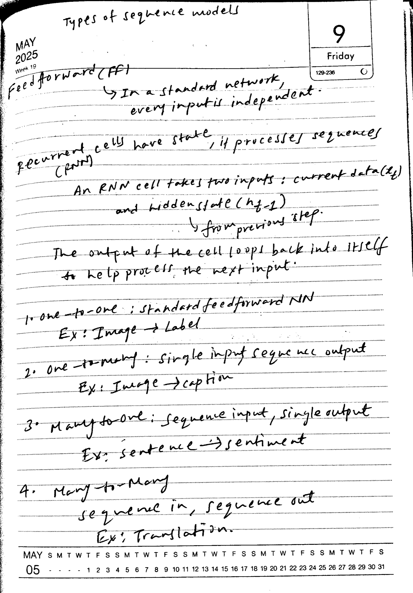

### Reference

Types of sequence models  

Feed forward (FF) → In a standard network, every input is independent.  

Recurrent cells have state, it processes sequences (RNN)  
An RNN cell takes two inputs: current data ($x_t$) and hidden state ($h_{t-1}$) from previous step.  
The output of the cell loops back into itself to help process the next input.  

1. one-to-one: standard feedforward NN  
Ex: Image → Label  
2. one-to-many: single input sequence output  
Ex: Image → caption  
3. many-to-one: sequence input, single output  
Ex: sentence → sentiment  
4. many-to-many  
sequence in, sequence out  
Ex: Translation.  

Raw text and LaTeX

Types of sequence models  

Feed forward (FF) → In a standard network, every input is independent.  

Recurrent cells have state, it processes sequences (RNN)  
An RNN cell takes two inputs: current data ($x_t$) and hidden state ($h_{t-1}$) from previous step.  
The output of the cell loops back into itself to help process the next input.  

1. one-to-one: standard feedforward NN  
Ex: Image → Label  
2. one-to-many: single input sequence output  
Ex: Image → caption  
3. many-to-one: sequence input, single output  
Ex: sentence → sentiment  
4. many-to-many  
sequence in, sequence out  
Ex: Translation.  

### 2200 px — 4.57 s; CER 37.1%

Types of sequence models  

May 2025  
Week 19  

Feedforward (FF)  

In a standard network, every input is independent.  

Recurrent cells have state, it processes sequences (RNN)  

An RNN cell takes two inputs: current data ($x_t$) and hidden state ($h_{t-1}$)  

from previous step.  

The output of the cell loops back into itself to help process the next input.  

4. Many-to-Many  

Sequence in, sequence out  

Ex: Translation.  

Raw text and LaTeX

Types of sequence models  

May 2025  
Week 19  

Feedforward (FF)  

In a standard network, every input is independent.  

Recurrent cells have state, it processes sequences (RNN)  

An RNN cell takes two inputs: current data ($x_t$) and hidden state ($h_{t-1}$)  

from previous step.  

The output of the cell loops back into itself to help process the next input.  

4. Many-to-Many  

Sequence in, sequence out  

Ex: Translation.  

### 1100 px — 2.54 s; CER 6.7%

Types of sequence models  

MAY 2025  
Week 19  

Feedforward (FF)  
In a standard network, every input is independent.  

Recurrent cells have state, it processes sequences (RNN)  

An RNN cell takes two inputs: current data ($t_j$) and hidden state ($h_{j-1}$)  

from previous step.  

The output of the cell loops back into itself to help process the next input.  

1. one → one; standard feedforward NN  
   Ex: Image → Label  

2. one → many: single input sequence output  
   Ex: Image → caption  

3. Many to one; sequence input, single output  
   Ex: sentence → sentiment  

4. Many to many  
   sequence in, sequence out  
   Ex: Translation.  

Raw text and LaTeX

Types of sequence models  

MAY 2025  
Week 19  

Feedforward (FF)  
In a standard network, every input is independent.  

Recurrent cells have state, it processes sequences (RNN)  

An RNN cell takes two inputs: current data ($t_j$) and hidden state ($h_{j-1}$)  

from previous step.  

The output of the cell loops back into itself to help process the next input.  

1. one → one; standard feedforward NN  
   Ex: Image → Label  

2. one → many: single input sequence output  
   Ex: Image → caption  

3. Many to one; sequence input, single output  
   Ex: sentence → sentiment  

4. Many to many  
   sequence in, sequence out  
   Ex: Translation.  

## handwriting-5-1

### Original page

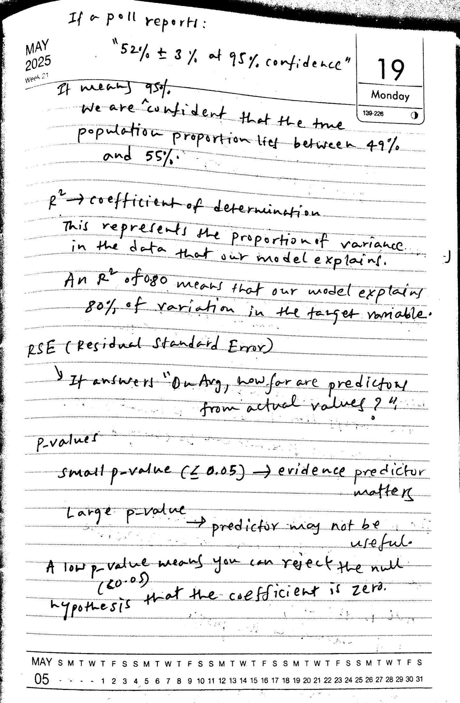

### Reference

If a poll reports:  
"52% ± 3% at 95% confidence"  
It means 95%. We are confident that the true population proportion lies between 49% and 55%.  

$R^2$ → coefficient of determination  
This represents the proportion of variance in the data that our model explains.  
An $R^2$ of 0.80 means that our model explains 80% of variation in the target variable.  

RSE (Residual Standard Error)  
It answers "On Avg, how far are predictions from actual values?"  

p-values  
Small p-value (≤ 0.05) → evidence predictor matters  
Large p-value → predictor may not be useful.  
A low p-value means you can reject the null hypothesis that the coefficient is zero. (<0.05)  

Raw text and LaTeX

If a poll reports:  
"52% ± 3% at 95% confidence"  
It means 95%. We are confident that the true population proportion lies between 49% and 55%.  

$R^2$ → coefficient of determination  
This represents the proportion of variance in the data that our model explains.  
An $R^2$ of 0.80 means that our model explains 80% of variation in the target variable.  

RSE (Residual Standard Error)  
It answers "On Avg, how far are predictions from actual values?"  

p-values  
Small p-value (≤ 0.05) → evidence predictor matters  
Large p-value → predictor may not be useful.  
A low p-value means you can reject the null hypothesis that the coefficient is zero. (<0.05)  

### 2200 px — 5.11 s; CER 28.5%; repeated text flagged

If a poll report:  

"52% ± 3% at 95% confidence"  

It means 95%.  
We are confident that the true population proportion lies between 49% and 55%.  

$R^2 \rightarrow$ coefficient of determination  
This represents the proportion of variance in the data that our model explains.  

An $R^2$ of 0.80 means that our model explains 80% of variation in the target variable.  

RSE (Residual Standard Error)  
An $R^2$ of 0.80 means that our model explains 80% of variation in the target variable.  

RSE (Residual Standard Error)  
An $R^2$ of 0.80 means that our model explains 80% of variation in the target variable.  

A low $p$-value means you can reject the null hypothesis that the coefficient is zero.  

Raw text and LaTeX

If a poll report:  

"52% ± 3% at 95% confidence"  

It means 95%.  
We are confident that the true population proportion lies between 49% and 55%.  

$R^2 \rightarrow$ coefficient of determination  
This represents the proportion of variance in the data that our model explains.  

An $R^2$ of 0.80 means that our model explains 80% of variation in the target variable.  

RSE (Residual Standard Error)  
An $R^2$ of 0.80 means that our model explains 80% of variation in the target variable.  

RSE (Residual Standard Error)  
An $R^2$ of 0.80 means that our model explains 80% of variation in the target variable.  

A low $p$-value means you can reject the null hypothesis that the coefficient is zero.  

### 1100 px — 2.73 s; CER 10.2%

If a poll report:  

"52% ± 3% at 95% confidence"  

It means 95%.  
We are confident that the true population proportion lies between 49% and 55%.  

$R^2 \rightarrow$ coefficient of determination  

This represents the proportion of variance in the data that our model explains.  

An $R^2$ of 0.80 means that our model explains 80% of variation in the target variable.  

RSE (Residual Standard Error)  

It answers "On Arg, how far are predictors from actual values?"  

$p$-values  

Small $p$-value ($\leq 0.05$) $\rightarrow$ evidence predictor matters  

Large $p$-value $\rightarrow$ predictor may not be useful.  

A low $p$-value means you can reject the null hypothesis that the coefficient is zero.  

Raw text and LaTeX

If a poll report:  

"52% ± 3% at 95% confidence"  

It means 95%.  
We are confident that the true population proportion lies between 49% and 55%.  

$R^2 \rightarrow$ coefficient of determination  

This represents the proportion of variance in the data that our model explains.  

An $R^2$ of 0.80 means that our model explains 80% of variation in the target variable.  

RSE (Residual Standard Error)  

It answers "On Arg, how far are predictors from actual values?"  

$p$-values  

Small $p$-value ($\leq 0.05$) $\rightarrow$ evidence predictor matters  

Large $p$-value $\rightarrow$ predictor may not be useful.  

A low $p$-value means you can reject the null hypothesis that the coefficient is zero.  

## handwriting-5-2

### Original page

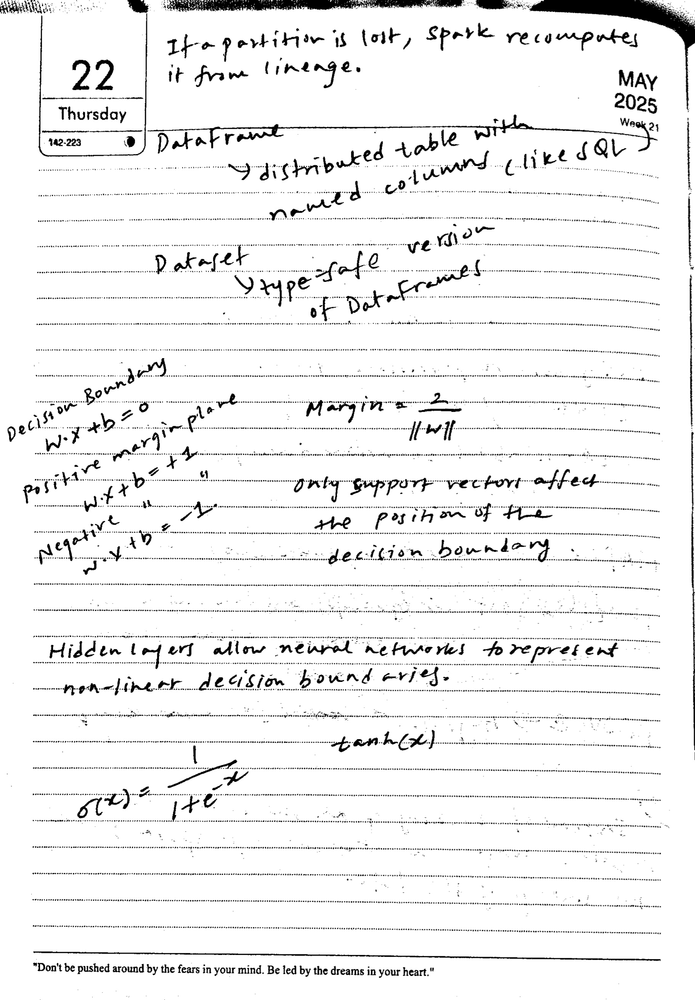

### Reference

If a partition is lost, Spark recomputes it from lineage.  

DataFrame → distributed table with named columns (like SQL)  
Dataset → type-safe version of DataFrames  

Decision Boundary  
$w\cdot x+b=0$  
positive margin plane  
$w\cdot x+b=+1$  
negative margin plane  
$w\cdot x+b=-1$  

Margin = $\frac{2}{\|w\|}$  
Only support vectors affect the position of the decision boundary.  

Hidden layers allow neural networks to represent non-linear decision boundaries.  

$\sigma(x)=\frac{1}{1+e^{-x}}$  
$\tanh(x)$  

Raw text and LaTeX

If a partition is lost, Spark recomputes it from lineage.  

DataFrame → distributed table with named columns (like SQL)  
Dataset → type-safe version of DataFrames  

Decision Boundary  
$w\cdot x+b=0$  
positive margin plane  
$w\cdot x+b=+1$  
negative margin plane  
$w\cdot x+b=-1$  

Margin = $\frac{2}{\|w\|}$  
Only support vectors affect the position of the decision boundary.  

Hidden layers allow neural networks to represent non-linear decision boundaries.  

$\sigma(x)=\frac{1}{1+e^{-x}}$  
$\tanh(x)$  

### 2200 px — 4.66 s; CER 44.1%

If a partition is lost, spark recomputes it from lineage.  

DataFrame  

distributed table with named columns (like SQL)  

Dataset  
type=safe version of DataFrames  

Decision Boundary  
W.x + b = 0  
positive margin plane  
W.x + b = +1  

Margin = $\frac{2}{\|W\|}$  

$\sigma(x) = \frac{1}{1 + e^{-x}}$  

"Don't be pushed around by the fears in your mind. Be led by the dreams in your heart."  

Raw text and LaTeX

If a partition is lost, spark recomputes it from lineage.  

DataFrame  

distributed table with named columns (like SQL)  

Dataset  
type=safe version of DataFrames  

Decision Boundary  
W.x + b = 0  
positive margin plane  
W.x + b = +1  

Margin = $\frac{2}{\|W\|}$  

$\sigma(x) = \frac{1}{1 + e^{-x}}$  

"Don't be pushed around by the fears in your mind. Be led by the dreams in your heart."  

### 1100 px — 2.47 s; CER 29.9%

If a partition is lost, spark recomputes it from lineage.  

DataFrame  

distributed table with named columns (like SQL)  

Dataset type=safe version of DataFrames  

Decision Boundary  
$W.x + b = 0$  
Positive margin plane  
$W.x + b = +1$  
Negative  
$W.x + b = -1$  

Margin $= \frac{2}{\|W\|}$  

Only support vectors affect the position of the decision boundary.  

Hidden layers allow neural networks to represent non-linear decision boundaries.  

$\sigma(x) = \frac{1}{1 + e^{-x}}$  

$\tanh(x)$  

"Don't be pushed around by the fears in your mind. Be led by the dreams in your heart."  

Raw text and LaTeX

If a partition is lost, spark recomputes it from lineage.  

DataFrame  

distributed table with named columns (like SQL)  

Dataset type=safe version of DataFrames  

Decision Boundary  
$W.x + b = 0$  
Positive margin plane  
$W.x + b = +1$  
Negative  
$W.x + b = -1$  

Margin $= \frac{2}{\|W\|}$  

Only support vectors affect the position of the decision boundary.  

Hidden layers allow neural networks to represent non-linear decision boundaries.  

$\sigma(x) = \frac{1}{1 + e^{-x}}$  

$\tanh(x)$  

"Don't be pushed around by the fears in your mind. Be led by the dreams in your heart."  

## handwriting-6-1

### Original page

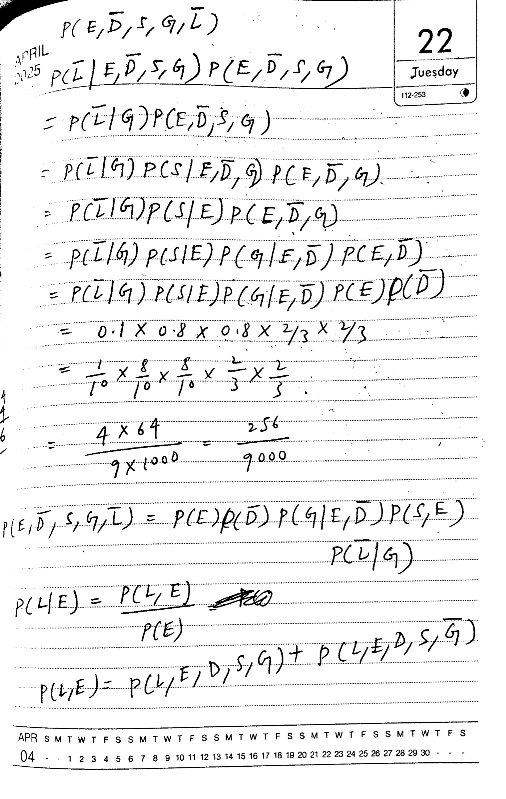

### Reference

$P(E,\bar D,S,G,\bar L)$  

$P(\bar L\mid E,\bar D,S,G)P(E,\bar D,S,G)$  

$=P(\bar L\mid G)P(E,\bar D,S,G)$  

$=P(\bar L\mid G)P(S\mid E,\bar D,G)P(E,\bar D,G)$  

$=P(\bar L\mid G)P(S\mid E)P(E,\bar D,G)$  

$=P(\bar L\mid G)P(S\mid E)P(G\mid E,\bar D)P(E,\bar D)$  

$=P(\bar L\mid G)P(S\mid E)P(G\mid E,\bar D)P(E)P(\bar D)$  

$=0.1\times0.8\times0.8\times\frac23\times\frac23$  

$=\frac1{10}\times\frac8{10}\times\frac8{10}\times\frac23\times\frac23$  

$=\frac{4\times64}{9\times1000}=\frac{256}{9000}$  

$P(E,\bar D,S,G,\bar L)=P(E)P(\bar D)P(G\mid E,\bar D)P(S,E)P(\bar L\mid G)$  

$P(L\mid E)=\frac{P(L,E)}{P(E)}$ [crossed-out text omitted]  

$P(L,E)=P(L,E,D,S,G)+P(L,E,D,S,\bar G)$  

Raw text and LaTeX

$P(E,\bar D,S,G,\bar L)$  

$P(\bar L\mid E,\bar D,S,G)P(E,\bar D,S,G)$  

$=P(\bar L\mid G)P(E,\bar D,S,G)$  

$=P(\bar L\mid G)P(S\mid E,\bar D,G)P(E,\bar D,G)$  

$=P(\bar L\mid G)P(S\mid E)P(E,\bar D,G)$  

$=P(\bar L\mid G)P(S\mid E)P(G\mid E,\bar D)P(E,\bar D)$  

$=P(\bar L\mid G)P(S\mid E)P(G\mid E,\bar D)P(E)P(\bar D)$  

$=0.1\times0.8\times0.8\times\frac23\times\frac23$  

$=\frac1{10}\times\frac8{10}\times\frac8{10}\times\frac23\times\frac23$  

$=\frac{4\times64}{9\times1000}=\frac{256}{9000}$  

$P(E,\bar D,S,G,\bar L)=P(E)P(\bar D)P(G\mid E,\bar D)P(S,E)P(\bar L\mid G)$  

$P(L\mid E)=\frac{P(L,E)}{P(E)}$ [crossed-out text omitted]  

$P(L,E)=P(L,E,D,S,G)+P(L,E,D,S,\bar G)$  

### 2200 px — 15.78 s; CER 246.3%; repeated text flagged

$P(E, \bar{D}, S, G, \bar{L})$  
$P(\bar{L} | E, \bar{D}, S, G) P(E, \bar{D}, S, G)$  

$= P(\bar{L} | G) P(E, \bar{D}, S, G)$  

$= P(\bar{L} | G) P(S | E, \bar{D}, G) P(E, \bar{D}, G)$  

$= P(\bar{L} | G) P(S | E) P(E, \bar{D}, G)$  

$= P(\bar{L} | G) P(S | E) P(G | E, \bar{D}) P(E, \bar{D})$  

$= P(\bar{L} | G) P(S | E) P(G | E, \bar{D}) P(E) P(\bar{D})$  

$= 0.1 \times 0.8 \times 0.8 \times \frac{2}{3} \times \frac{2}{3}$  

$= \frac{1}{10} \times \frac{8}{10} \times \frac{8}{10} \times \frac{2}{3} \times \frac{2}{3}$  

$= \frac{1}{10} \times \frac{8}{10} \times \frac{8}{10} \times \frac{2}{3} \times \frac{2}{3}$  

$= P(L | E) = P(L, E, D, S, G)$  

$P(L | E) = P(L, E, D, S, G) + P(L, E, D, S, \bar{G})$  

$P(L | E) = P(L, E, D, S, G) + P(L, E, D, S, \bar{G})$  

APRIL  
2025  

22  
Juesday  
112-253  

$P(E, \bar{D}, S, G, \bar{L})$  
$P(\bar{L} | E, \bar{D}, S, G) P(E, \bar{D}, S, G)$  

$= P(\bar{L} | G) P(E, \bar{D}, S, G)$  

$= P(\bar{L} | G) P(S | E, \bar{D}, G) P(E, \bar{D}, G)$  

$= P(\bar{L} | G) P(S | E) P(G | E, \bar{D}) P(E, \bar{D})$  

$= P(\bar{L} | G) P(S | E) P(G | E, \bar{D}) P(E) P(\bar{D})$  

$= 0.1 \times 0.8 \times 0.8 \times \frac{2}{3} \times \frac{2}{3}$  

$= \frac{1}{10} \times \frac{8}{10} \times \frac{8}{10} \times \frac{2}{3} \times \frac{2}{3}$  

$= P(L | E) = P(L, E, D, S, G)$  

$P(L | E) = P(L, E, D, S, \bar{G})$  

$P(L | E) = P(L, E, D, S, \bar{G}) + P(L, E, D, S, \bar{G})$  

APR SMTWTFSSSMTWTWTFTFSFSFSFSFSFSFSFSFSFSFSFSFSFSFSFSFSFSFSFSFSFSFSFSFSFSFSFSFSFSFSFSFSFSFSFSFSFSFSFSFSFSFSFSFSFSFSFSFSFSFSFSFSFSFSFSFSFSFSFSFSFSFSFSFSFSFSFSFSFSFSFSFSFSFSFSFSFSFSFSFSFSFSFSFSFSFSFSFSFSFSFSFSFSFSFSFSFSFSFSFSFSFSFSFSFSFSFSFSFSFSFSFSFSFSFSFSFSFSFSFSFSFSFSFSFSFSFSFSFSFSFSFSFSFSFSFSFSFSFSFSFSFSFSFSFSFSFSFSFSFSFSFSFSFSFSFSFSFSFSFSFSFSFSFSFSFSFSFSFSFSFSFSFSFSFSFSFSFSFSFSFSFSFSFSFSFSFSFSFSFSFSFSFSFSFSFSFSFSFSFSFSFSFSFSFSFSFSFSFSFSFSFSFSFSFSFSFSFSFSFSFSFSFSFSFSFSFSFSFSFSFSFSFSFSFSFSFSFSFSFSFSFSFSFSFSFSFSFSFSFSFSFSFSFSFSFSFSFSFSFSFSFSFSFSFSFSFSFSFSFSFSFSFSFSFSFSFSFSFSFSFSFSFSFSFSFSFSFSFSFSFSFSFSFSFSFSFSFSFSFSFSFSFSFSFSFSFSFSFSFSFSFSFSFSFSFSFSFSFSFSFSFSFSFSFSFSFSFSFSFSFSFSFSFSFSFSFSFSFSFSFSFSFSFSFSFSFSFSFSFSFSFSFSFSFSFSFSFSFSFSFSFSFSFSFSFSFSFSFSFSFSFSFSFSFSFSFSFSFSFSFS  

Raw text and LaTeX

$P(E, \bar{D}, S, G, \bar{L})$  
$P(\bar{L} | E, \bar{D}, S, G) P(E, \bar{D}, S, G)$  

$= P(\bar{L} | G) P(E, \bar{D}, S, G)$  

$= P(\bar{L} | G) P(S | E, \bar{D}, G) P(E, \bar{D}, G)$  

$= P(\bar{L} | G) P(S | E) P(E, \bar{D}, G)$  

$= P(\bar{L} | G) P(S | E) P(G | E, \bar{D}) P(E, \bar{D})$  

$= P(\bar{L} | G) P(S | E) P(G | E, \bar{D}) P(E) P(\bar{D})$  

$= 0.1 \times 0.8 \times 0.8 \times \frac{2}{3} \times \frac{2}{3}$  

$= \frac{1}{10} \times \frac{8}{10} \times \frac{8}{10} \times \frac{2}{3} \times \frac{2}{3}$  

$= \frac{1}{10} \times \frac{8}{10} \times \frac{8}{10} \times \frac{2}{3} \times \frac{2}{3}$  

$= P(L | E) = P(L, E, D, S, G)$  

$P(L | E) = P(L, E, D, S, G) + P(L, E, D, S, \bar{G})$  

$P(L | E) = P(L, E, D, S, G) + P(L, E, D, S, \bar{G})$  

APRIL  
2025  

22  
Juesday  
112-253  

$P(E, \bar{D}, S, G, \bar{L})$  
$P(\bar{L} | E, \bar{D}, S, G) P(E, \bar{D}, S, G)$  

$= P(\bar{L} | G) P(E, \bar{D}, S, G)$  

$= P(\bar{L} | G) P(S | E, \bar{D}, G) P(E, \bar{D}, G)$  

$= P(\bar{L} | G) P(S | E) P(G | E, \bar{D}) P(E, \bar{D})$  

$= P(\bar{L} | G) P(S | E) P(G | E, \bar{D}) P(E) P(\bar{D})$  

$= 0.1 \times 0.8 \times 0.8 \times \frac{2}{3} \times \frac{2}{3}$  

$= \frac{1}{10} \times \frac{8}{10} \times \frac{8}{10} \times \frac{2}{3} \times \frac{2}{3}$  

$= P(L | E) = P(L, E, D, S, G)$  

$P(L | E) = P(L, E, D, S, \bar{G})$  

$P(L | E) = P(L, E, D, S, \bar{G}) + P(L, E, D, S, \bar{G})$  

APR SMTWTFSSSMTWTWTFTFSFSFSFSFSFSFSFSFSFSFSFSFSFSFSFSFSFSFSFSFSFSFSFSFSFSFSFSFSFSFSFSFSFSFSFSFSFSFSFSFSFSFSFSFSFSFSFSFSFSFSFSFSFSFSFSFSFSFSFSFSFSFSFSFSFSFSFSFSFSFSFSFSFSFSFSFSFSFSFSFSFSFSFSFSFSFSFSFSFSFSFSFSFSFSFSFSFSFSFSFSFSFSFSFSFSFSFSFSFSFSFSFSFSFSFSFSFSFSFSFSFSFSFSFSFSFSFSFSFSFSFSFSFSFSFSFSFSFSFSFSFSFSFSFSFSFSFSFSFSFSFSFSFSFSFSFSFSFSFSFSFSFSFSFSFSFSFSFSFSFSFSFSFSFSFSFSFSFSFSFSFSFSFSFSFSFSFSFSFSFSFSFSFSFSFSFSFSFSFSFSFSFSFSFSFSFSFSFSFSFSFSFSFSFSFSFSFSFSFSFSFSFSFSFSFSFSFSFSFSFSFSFSFSFSFSFSFSFSFSFSFSFSFSFSFSFSFSFSFSFSFSFSFSFSFSFSFSFSFSFSFSFSFSFSFSFSFSFSFSFSFSFSFSFSFSFSFSFSFSFSFSFSFSFSFSFSFSFSFSFSFSFSFSFSFSFSFSFSFSFSFSFSFSFSFSFSFSFSFSFSFSFSFSFSFSFSFSFSFSFSFSFSFSFSFSFSFSFSFSFSFSFSFSFSFSFSFSFSFSFSFSFSFSFSFSFSFSFSFSFSFSFSFSFSFSFSFSFSFSFSFSFSFSFSFSFSFSFSFSFSFSFSFSFSFSFSFSFSFSFSFS  

### 1100 px — 5.40 s; CER 37.1%

$P(E, \bar{D}, S, G, \bar{L})$  
$P(\bar{L} | E, \bar{D}, S, G) P(E, \bar{D}, S, G)$  

$= P(\bar{L} | G) P(E, \bar{D}, S, G)$  

$= P(\bar{L} | G) P(S | E, \bar{D}, G) P(E, \bar{D}, G)$  

$= P(\bar{L} | G) P(S | E) P(E, \bar{D}, G)$  

$= P(\bar{L} | G) P(S | E) P(G | E, \bar{D}) P(E, \bar{D})$  

$= P(\bar{L} | G) P(S | E) P(G | E, \bar{D}) P(E) P(\bar{D})$  

$= 0.1 \times 0.8 \times 0.8 \times \frac{2}{3} \times \frac{2}{3}$  

$= \frac{1}{10} \times \frac{8}{10} \times \frac{8}{10} \times \frac{2}{3} \times \frac{2}{3}$  

$= \frac{4 \times 64}{9 \times 1000} = \frac{256}{9000}$  

$P(E, \bar{D}, S, G, \bar{L}) = P(E) P(\bar{D}) P(G | E, \bar{D}) P(S, E)$  

$P(\bar{L} | G)$  

$P(L | E) = \frac{P(L, E)}{P(E)}$  

$P(L, E) = P(L, E, D, S, G) + P(L, E, D, S, \bar{G})$  

Raw text and LaTeX

$P(E, \bar{D}, S, G, \bar{L})$  
$P(\bar{L} | E, \bar{D}, S, G) P(E, \bar{D}, S, G)$  

$= P(\bar{L} | G) P(E, \bar{D}, S, G)$  

$= P(\bar{L} | G) P(S | E, \bar{D}, G) P(E, \bar{D}, G)$  

$= P(\bar{L} | G) P(S | E) P(E, \bar{D}, G)$  

$= P(\bar{L} | G) P(S | E) P(G | E, \bar{D}) P(E, \bar{D})$  

$= P(\bar{L} | G) P(S | E) P(G | E, \bar{D}) P(E) P(\bar{D})$  

$= 0.1 \times 0.8 \times 0.8 \times \frac{2}{3} \times \frac{2}{3}$  

$= \frac{1}{10} \times \frac{8}{10} \times \frac{8}{10} \times \frac{2}{3} \times \frac{2}{3}$  

$= \frac{4 \times 64}{9 \times 1000} = \frac{256}{9000}$  

$P(E, \bar{D}, S, G, \bar{L}) = P(E) P(\bar{D}) P(G | E, \bar{D}) P(S, E)$  

$P(\bar{L} | G)$  

$P(L | E) = \frac{P(L, E)}{P(E)}$  

$P(L, E) = P(L, E, D, S, G) + P(L, E, D, S, \bar{G})$  

## handwriting-6-2

### Original page

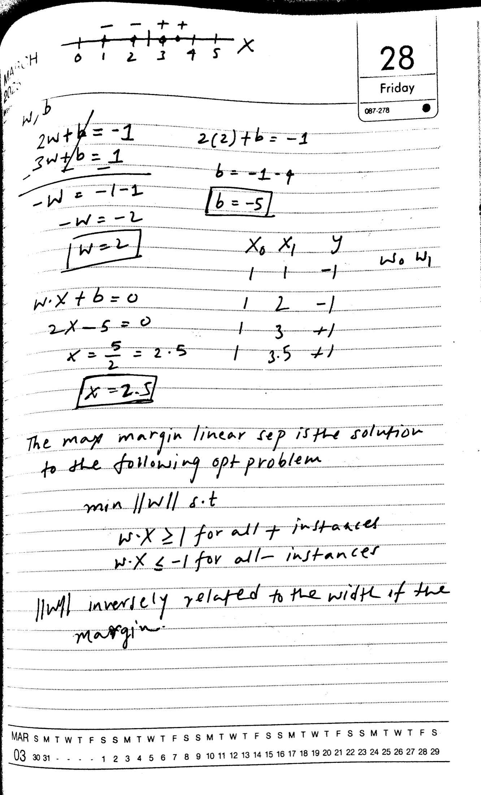

### Reference

[Diagram: x number line with labeled ticks 0 to 5; negative points at 1 and 2, positive points at 3 and 3.5; marks indicate a dividing point near 2.5.]  

w, b  

$2w+b=-1$  
$3w+b=1$  
$-w=-1-1$  
$-w=-2$  
$w=2$  

$2(2)+b=-1$  
$b=-1-4$  
$b=-5$  

$w\cdot x+b=0$  
$2x-5=0$  
$x=\frac52=2.5$  
$x=2.5$  

[Table: columns $x_0,x_1,y$; rows 1,1,-1; 1,2,-1; 1,3,+1; 1,3.5,+1. Handwritten $w_0,w_1$ beside the table.]  

The max margin linear sep is the solution to the following opt problem  

$\min \lVert w\rVert$ s.t.  
$w\cdot x\geq1$ for all + instances  
$w\cdot x\leq-1$ for all − instances  

$\lVert w\rVert$ inversely related to the width of the margin.  

Raw text and LaTeX

[Diagram: x number line with labeled ticks 0 to 5; negative points at 1 and 2, positive points at 3 and 3.5; marks indicate a dividing point near 2.5.]  

w, b  

$2w+b=-1$  
$3w+b=1$  
$-w=-1-1$  
$-w=-2$  
$w=2$  

$2(2)+b=-1$  
$b=-1-4$  
$b=-5$  

$w\cdot x+b=0$  
$2x-5=0$  
$x=\frac52=2.5$  
$x=2.5$  

[Table: columns $x_0,x_1,y$; rows 1,1,-1; 1,2,-1; 1,3,+1; 1,3.5,+1. Handwritten $w_0,w_1$ beside the table.]  

The max margin linear sep is the solution to the following opt problem  

$\min \lVert w\rVert$ s.t.  
$w\cdot x\geq1$ for all + instances  
$w\cdot x\leq-1$ for all − instances  

$\lVert w\rVert$ inversely related to the width of the margin.  

### 2200 px — 5.50 s; CER 74.8%; repeated text flagged

28  
Friday  
087-278  

$w_1 b$  
$2w + b = -1$  
$3w + b = 1$  

$-W = -1 - 1$  
$-W = -2$  
$W = 2$  

$2(2) + b = -1$  
$b = -1 - 4$  
$b = -5$  

$x_0 x_1 y$  
1 1 -1 $w_0 w_1$  

$w \cdot x + b = 0$  
$2x - 5 = 0$  
$x = \frac{5}{2} = 2.5$  
$x = 2.5$  

The max margin linear sep is $w_1 w_0$  
$2x - 5 = 0$  
$x = \frac{5}{2} = 2.5$  
$x = 2.5$  

The max margin linear sep is $w_1 w_0$  
$2x - 5 = 0$  
$x = \frac{5}{2} = 2.5$  
$x = 2.5$  

Raw text and LaTeX

28  
Friday  
087-278  

$w_1 b$  
$2w + b = -1$  
$3w + b = 1$  

$-W = -1 - 1$  
$-W = -2$  
$W = 2$  

$2(2) + b = -1$  
$b = -1 - 4$  
$b = -5$  

$x_0 x_1 y$  
1 1 -1 $w_0 w_1$  

$w \cdot x + b = 0$  
$2x - 5 = 0$  
$x = \frac{5}{2} = 2.5$  
$x = 2.5$  

The max margin linear sep is $w_1 w_0$  
$2x - 5 = 0$  
$x = \frac{5}{2} = 2.5$  
$x = 2.5$  

The max margin linear sep is $w_1 w_0$  
$2x - 5 = 0$  
$x = \frac{5}{2} = 2.5$  
$x = 2.5$  

### 1100 px — 3.12 s; CER 54.9%

28 Friday  
067-278  

$w_1 b$  
$2 w + b = -1$  
$3 w + b = 1$  
$-w = -1 - 2$  
$-w = -2$  
$W = 2$  

$2(2) + b = -1$  
$b = -1 - 4$  
$b = -5$  

$X_0 X_1 y$  
1 1 -1 $w_0 w_1$  

$w \cdot X + b = 0$  
$2 x - 5 = 0$  
$x = \frac{5}{2} = 2.5$  
$x = 2.5$  

The max margin linear sep is the solution to the following opt problem  
min $||W||$ s.t.  
$w \cdot X \geq 1$ for all $+$ instances  
$w \cdot X \leq -1$ for all $-$ instances  

$||W||$ inversely related to the width of the margin.  

Raw text and LaTeX

28 Friday  
067-278  

$w_1 b$  
$2 w + b = -1$  
$3 w + b = 1$  
$-w = -1 - 2$  
$-w = -2$  
$W = 2$  

$2(2) + b = -1$  
$b = -1 - 4$  
$b = -5$  

$X_0 X_1 y$  
1 1 -1 $w_0 w_1$  

$w \cdot X + b = 0$  
$2 x - 5 = 0$  
$x = \frac{5}{2} = 2.5$  
$x = 2.5$  

The max margin linear sep is the solution to the following opt problem  
min $||W||$ s.t.  
$w \cdot X \geq 1$ for all $+$ instances  
$w \cdot X \leq -1$ for all $-$ instances  

$||W||$ inversely related to the width of the margin.  

## handwriting-6-3

### Original page

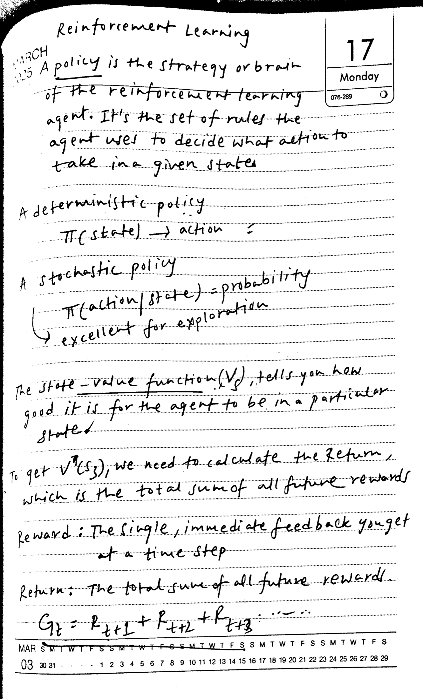

### Reference

Reinforcement Learning  

A policy is the strategy or brain of the reinforcement learning agent. It's the set of rules the agent uses to decide what action to take in a given state.  

A deterministic policy  
$\pi(\mathrm{state})\rightarrow\mathrm{action}$  

A stochastic policy  
$\pi(\mathrm{action}\mid\mathrm{state})=\mathrm{probability}$  
→ excellent for exploration  

The state-value function $(V_s)$, tells you how good it is for the agent to be in a particular state.  

To get $V^\pi(s_3)$, we need to calculate the Return, which is the total sum of all future rewards.  

Reward: The single, immediate feedback you get at a time step  

Return: The total sum of all future rewards  

$G_t=R_{t+1}+R_{t+2}+R_{t+3}+\cdots$  

Raw text and LaTeX

Reinforcement Learning  

A policy is the strategy or brain of the reinforcement learning agent. It's the set of rules the agent uses to decide what action to take in a given state.  

A deterministic policy  
$\pi(\mathrm{state})\rightarrow\mathrm{action}$  

A stochastic policy  
$\pi(\mathrm{action}\mid\mathrm{state})=\mathrm{probability}$  
→ excellent for exploration  

The state-value function $(V_s)$, tells you how good it is for the agent to be in a particular state.  

To get $V^\pi(s_3)$, we need to calculate the Return, which is the total sum of all future rewards.  

Reward: The single, immediate feedback you get at a time step  

Return: The total sum of all future rewards  

$G_t=R_{t+1}+R_{t+2}+R_{t+3}+\cdots$  

### 2200 px — 4.38 s; CER 33.0%

Reinforcement Learning  

A policy is the strategy or brain of the reinforcement learning agent. It's the set of rules the agent uses to decide what action to take in a given state.  

A deterministic policy  

$$
\pi(\text{state}) \rightarrow \text{action}  
$$

A stochastic policy  

$$
\pi(\text{action}|\text{state}) = \text{probability}  
$$

excellent for exploration  

The state-value function $(V_s)$ tells you how good the action/state = probability is.  

Return: The total sum of all future rewards  

$$
G_t = R_{t+1} + R_{t+2} + R_{t+3}  
$$

Raw text and LaTeX

Reinforcement Learning  

A policy is the strategy or brain of the reinforcement learning agent. It's the set of rules the agent uses to decide what action to take in a given state.  

A deterministic policy  

$$
\pi(\text{state}) \rightarrow \text{action}  
$$

A stochastic policy  

$$
\pi(\text{action}|\text{state}) = \text{probability}  
$$

excellent for exploration  

The state-value function $(V_s)$ tells you how good the action/state = probability is.  

Return: The total sum of all future rewards  

$$
G_t = R_{t+1} + R_{t+2} + R_{t+3}  
$$

### 1100 px — 2.79 s; CER 8.2%

Reinforcement Learning  

policy is the strategy or brain of the reinforcement learning agent. It's the set of rules the agent uses to decide what action to take in a given state.  

A deterministic policy  

$$
\pi(\text{state}) \rightarrow \text{action}  
$$

A stochastic policy  

$$
\pi(\text{action}|\text{state}) = \text{probability}  
$$

excellent for exploration  

The state-value function $(V_s)$ tells you how good it is for the agent to be in a particular state.  

To get $V^T(s_3)$, we need to calculate the return, which is the total sum of all future rewards.  

Reward: The single immediate feedback you get at a time step  

Return: The total sum of all future rewards.  

$$
G_2 = R_{t+1} + R_{t+2} + R_{t+3}  
$$

Raw text and LaTeX

Reinforcement Learning  

policy is the strategy or brain of the reinforcement learning agent. It's the set of rules the agent uses to decide what action to take in a given state.  

A deterministic policy  

$$
\pi(\text{state}) \rightarrow \text{action}  
$$

A stochastic policy  

$$
\pi(\text{action}|\text{state}) = \text{probability}  
$$

excellent for exploration  

The state-value function $(V_s)$ tells you how good it is for the agent to be in a particular state.  

To get $V^T(s_3)$, we need to calculate the return, which is the total sum of all future rewards.  

Reward: The single immediate feedback you get at a time step  

Return: The total sum of all future rewards.  

$$
G_2 = R_{t+1} + R_{t+2} + R_{t+3}  
$$

## handwriting-7-1

### Original page

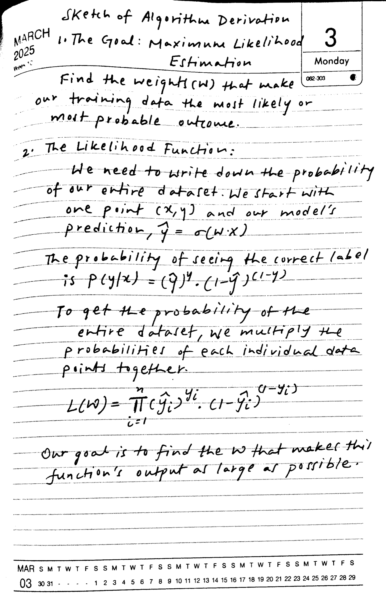

### Reference

Sketch of Algorithm Derivation  

1. The Goal: Maximum Likelihood Estimation  

Find the weights (w) that make our training data the most likely or most probable outcome.  

2. The Likelihood Function:  

We need to write down the probability of our entire dataset. We start with one point (x,y) and our model's prediction, $\hat y=\sigma(w\cdot x)$  

The probability of seeing the correct label is $P(y\mid x)=(\hat y)^y\cdot(1-\hat y)^{(1-y)}$  

To get the probability of the entire dataset, we multiply the probabilities of each individual data point together.  

$L(w)=\prod_{i=1}^{n}(\hat y_i)^{y_i}\cdot(1-\hat y_i)^{(1-y_i)}$  

Our goal is to find the w that makes this function's output as large as possible.  

Raw text and LaTeX

Sketch of Algorithm Derivation  

1. The Goal: Maximum Likelihood Estimation  

Find the weights (w) that make our training data the most likely or most probable outcome.  

2. The Likelihood Function:  

We need to write down the probability of our entire dataset. We start with one point (x,y) and our model's prediction, $\hat y=\sigma(w\cdot x)$  

The probability of seeing the correct label is $P(y\mid x)=(\hat y)^y\cdot(1-\hat y)^{(1-y)}$  

To get the probability of the entire dataset, we multiply the probabilities of each individual data point together.  

$L(w)=\prod_{i=1}^{n}(\hat y_i)^{y_i}\cdot(1-\hat y_i)^{(1-y_i)}$  

Our goal is to find the w that makes this function's output as large as possible.  

### 2200 px — 15.92 s; CER 480.4%; repeated text flagged

Sketch of Algorithm Derivation  

1. The Goal: Maximum Likelihood Estimation  

Find the weights $W$ that make our training data the most likely or most probable outcome.  

2. The Likelihood Function:  

We need to write down the probability of our entire dataset. We start with one point $(x, y)$ and our model's prediction, $\hat{y} = \sigma(W \cdot x)$  

The probability of seeing the correct label is $P(y|x) = (\hat{y})^y \cdot (1 - \hat{y})^{1-y}$  

To get the probability of the entire dataset, we need to find the correct label for each point $(x, y)$. The probability of seeing the correct label is $P(y|x) = (\hat{y})^y \cdot (1 - \hat{y})^{1-y}$  

To get the probability of the entire dataset, we need to find the correct label for each point $(x, y)$. The probability of seeing the correct label is $P(y|x) = (\hat{y})^y \cdot (1 - \hat{y})^{1-y}$  

Our goal is to find the probability of the entire dataset, we need to find the correct label for each point $(x, y)$. The probability of seeing the correct label is $P(y|x) = (\hat{y})^y \cdot (1 - \hat{y})^{1-y}$  

Our goal is to find the probability of the entire dataset, we need to find the correct label for each point $(x, y)$. The probability of seeing the correct label is $P(y|x) = (\hat{y})^y \cdot (1 - \hat{y})^{1-y}$  

Our goal is to find the probability of the entire dataset, we need to find the correct label for each point $(x, y)$. The probability of seeing the correct label is $P(y|x) = (\hat{y})^y \cdot (1 - \hat{y})^{1-y}$  

Our goal is to find the probability of the entire dataset, we need to find the correct label for each point $(x, y)$. The probability of seeing the correct label is $P(y|x) = (\hat{y})^y \cdot (1 - \hat{y})^{1-y}$  

Our goal is to find the probability of the entire dataset, we need to find the correct label for each point $(x, y)$. The probability of seeing the correct label is $P(y|x) = (\hat{y})^y \cdot (1 - \hat{y})^{1-y}$  

Our goal is to find the probability of the entire dataset, we need to find the correct label for each point $(x, y)$. The probability of seeing the correct label is $P(y|x) = (\hat{y})^y \cdot (1 - \hat{y})^{1-y}$  

Our goal is to find the probability of the entire dataset, we need to find the correct label for each point $(x, y)$. The probability of seeing the correct label is $P(y|x) = (\hat{y})^y \cdot (1 - \hat{y})^{1-y}$  

Our goal is to find the probability of the entire dataset, we need to find the correct label for each point $(x, y)$. The probability of seeing the correct label is $P(y|x) = (\hat{y})^y \cdot (1 - \hat{y})^{1-y}$  

Our goal is to find the probability of the entire dataset, we need to find the correct label for each point $(x, y)$. The probability of seeing the correct label is $P(y|x) = (\hat{y})^y \cdot (1 - \hat{y})^{1-y}$  

Our goal is to find the probability of the entire dataset, we need to find the correct label for each point $(x, y)$. The probability of seeing the correct label is $P(y|x) = (\hat{y})^y \cdot (1 - \hat{y})^{1-y}$  

Our goal is to find the probability of the entire dataset, we need to find the correct label for each point $(x, y)$. The probability of seeing the correct label is $P(y|x) = (\hat{y})^y \cdot (1 - \hat{y})^{1-y}$  

Our goal is to find the probability of the entire dataset, we need to find the correct label for each point $(x, y)$. The probability of seeing the correct label is $P(y|x) = (\hat{y})^y \cdot (1 - \hat{y})^{1-y}$  

Our goal is to find the probability of the entire dataset, we need to find the correct label for each point $(x, y)$. The probability of seeing the correct label is $P(y|x) = (\hat{y})^y \cdot (1 - \hat{y})^{1-y}$  

Our goal is to find the probability of the entire dataset, we need to find the correct label for each point $(x, y)$. The probability of seeing the correct label is $P(y|x) = (\hat{y})^y \cdot (1 - \hat{y})^{1-y}$  

Our goal is to find the probability of the entire dataset, we need to find the correct label for each point $(x, y)$. The probability of seeing the correct label is $P  

Raw text and LaTeX

Sketch of Algorithm Derivation  

1. The Goal: Maximum Likelihood Estimation  

Find the weights $W$ that make our training data the most likely or most probable outcome.  

2. The Likelihood Function:  

We need to write down the probability of our entire dataset. We start with one point $(x, y)$ and our model's prediction, $\hat{y} = \sigma(W \cdot x)$  

The probability of seeing the correct label is $P(y|x) = (\hat{y})^y \cdot (1 - \hat{y})^{1-y}$  

To get the probability of the entire dataset, we need to find the correct label for each point $(x, y)$. The probability of seeing the correct label is $P(y|x) = (\hat{y})^y \cdot (1 - \hat{y})^{1-y}$  

To get the probability of the entire dataset, we need to find the correct label for each point $(x, y)$. The probability of seeing the correct label is $P(y|x) = (\hat{y})^y \cdot (1 - \hat{y})^{1-y}$  

Our goal is to find the probability of the entire dataset, we need to find the correct label for each point $(x, y)$. The probability of seeing the correct label is $P(y|x) = (\hat{y})^y \cdot (1 - \hat{y})^{1-y}$  

Our goal is to find the probability of the entire dataset, we need to find the correct label for each point $(x, y)$. The probability of seeing the correct label is $P(y|x) = (\hat{y})^y \cdot (1 - \hat{y})^{1-y}$  

Our goal is to find the probability of the entire dataset, we need to find the correct label for each point $(x, y)$. The probability of seeing the correct label is $P(y|x) = (\hat{y})^y \cdot (1 - \hat{y})^{1-y}$  

Our goal is to find the probability of the entire dataset, we need to find the correct label for each point $(x, y)$. The probability of seeing the correct label is $P(y|x) = (\hat{y})^y \cdot (1 - \hat{y})^{1-y}$  

Our goal is to find the probability of the entire dataset, we need to find the correct label for each point $(x, y)$. The probability of seeing the correct label is $P(y|x) = (\hat{y})^y \cdot (1 - \hat{y})^{1-y}$  

Our goal is to find the probability of the entire dataset, we need to find the correct label for each point $(x, y)$. The probability of seeing the correct label is $P(y|x) = (\hat{y})^y \cdot (1 - \hat{y})^{1-y}$  

Our goal is to find the probability of the entire dataset, we need to find the correct label for each point $(x, y)$. The probability of seeing the correct label is $P(y|x) = (\hat{y})^y \cdot (1 - \hat{y})^{1-y}$  

Our goal is to find the probability of the entire dataset, we need to find the correct label for each point $(x, y)$. The probability of seeing the correct label is $P(y|x) = (\hat{y})^y \cdot (1 - \hat{y})^{1-y}$  

Our goal is to find the probability of the entire dataset, we need to find the correct label for each point $(x, y)$. The probability of seeing the correct label is $P(y|x) = (\hat{y})^y \cdot (1 - \hat{y})^{1-y}$  

Our goal is to find the probability of the entire dataset, we need to find the correct label for each point $(x, y)$. The probability of seeing the correct label is $P(y|x) = (\hat{y})^y \cdot (1 - \hat{y})^{1-y}$  

Our goal is to find the probability of the entire dataset, we need to find the correct label for each point $(x, y)$. The probability of seeing the correct label is $P(y|x) = (\hat{y})^y \cdot (1 - \hat{y})^{1-y}$  

Our goal is to find the probability of the entire dataset, we need to find the correct label for each point $(x, y)$. The probability of seeing the correct label is $P(y|x) = (\hat{y})^y \cdot (1 - \hat{y})^{1-y}$  

Our goal is to find the probability of the entire dataset, we need to find the correct label for each point $(x, y)$. The probability of seeing the correct label is $P(y|x) = (\hat{y})^y \cdot (1 - \hat{y})^{1-y}$  

Our goal is to find the probability of the entire dataset, we need to find the correct label for each point $(x, y)$. The probability of seeing the correct label is $P(y|x) = (\hat{y})^y \cdot (1 - \hat{y})^{1-y}$  

Our goal is to find the probability of the entire dataset, we need to find the correct label for each point $(x, y)$. The probability of seeing the correct label is $P  

### 1100 px — 3.03 s; CER 6.2%

Sketch of Algorithm Derivation  

1. The Goal: Maximum Likelihood Estimation  

Find the weights $w$ that make our training data the most likely or most probable outcome.  

2. The Likelihood Function:  

We need to write down the probability of our entire dataset. We start with one point $(x, y)$ and our model's prediction, $\hat{y} = \sigma(w \cdot x)$.  

The probability of seeing the correct label is $p(y|x) = (\hat{y})^y \cdot (1 - \hat{y})^{(1-y)}$.  

To get the probability of the entire dataset, we multiply the probabilities of each individual data points together.  

$$
L(w) = \prod_{i=1}^{n} (\hat{y}_i)^y_i \cdot (1 - \hat{y}_i)^{(1-y_i)}  
$$

Our goal is to find the $w$ that makes this function's output as large as possible.  

Raw text and LaTeX

Sketch of Algorithm Derivation  

1. The Goal: Maximum Likelihood Estimation  

Find the weights $w$ that make our training data the most likely or most probable outcome.  

2. The Likelihood Function:  

We need to write down the probability of our entire dataset. We start with one point $(x, y)$ and our model's prediction, $\hat{y} = \sigma(w \cdot x)$.  

The probability of seeing the correct label is $p(y|x) = (\hat{y})^y \cdot (1 - \hat{y})^{(1-y)}$.  

To get the probability of the entire dataset, we multiply the probabilities of each individual data points together.  

$$
L(w) = \prod_{i=1}^{n} (\hat{y}_i)^y_i \cdot (1 - \hat{y}_i)^{(1-y_i)}  
$$

Our goal is to find the $w$ that makes this function's output as large as possible.  

## handwriting-7-2

### Original page

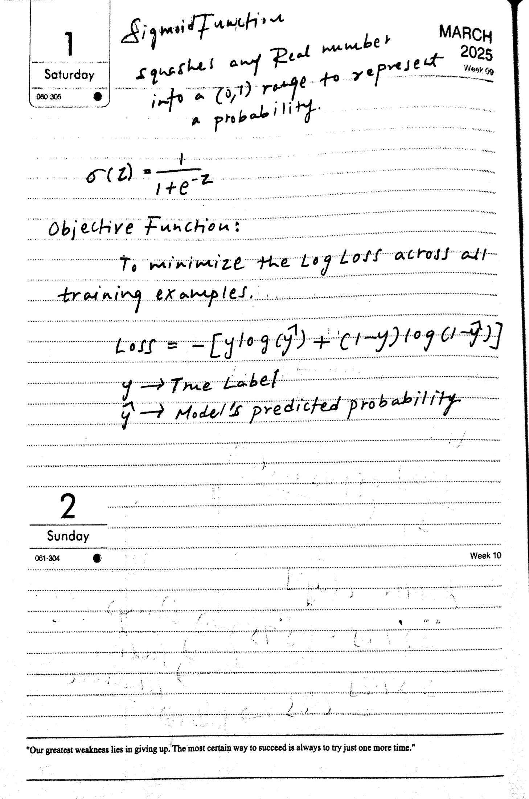

### Reference

Sigmoid Function  

squashes any Real number into a (0,1) range to represent a probability.  

$\sigma(z)=\frac{1}{1+e^{-z}}$  

Objective Function:  

To minimize the Log Loss across all training examples.  

$\mathrm{Loss}=-[y\log(\hat y)+(1-y)\log(1-\hat y)]$  

$y$ → True Label  

$\hat y$ → Model's predicted probability  

Raw text and LaTeX

Sigmoid Function  

squashes any Real number into a (0,1) range to represent a probability.  

$\sigma(z)=\frac{1}{1+e^{-z}}$  

Objective Function:  

To minimize the Log Loss across all training examples.  

$\mathrm{Loss}=-[y\log(\hat y)+(1-y)\log(1-\hat y)]$  

$y$ → True Label  

$\hat y$ → Model's predicted probability  

### 2200 px — 4.64 s; CER 56.1%

Sigmoid Function squashes any Real number into a (0,1) range to represent a probability.  

$$
\sigma(z) = \frac{1}{1 + e^{-z}}  
$$

Objective Function:  

To minimize the Log Loss across all training examples.  

$$
\text{Loss} = -[y \log(y^2) + (1-y) \log(1-y)]  
$$

$y \rightarrow \text{True Label}$  

$\hat{y} \rightarrow \text{True Label}$  

"Our greatest weakness lies in giving up. The most certain way to succeed is always to try just one more time."  

Raw text and LaTeX

Sigmoid Function squashes any Real number into a (0,1) range to represent a probability.  

$$
\sigma(z) = \frac{1}{1 + e^{-z}}  
$$

Objective Function:  

To minimize the Log Loss across all training examples.  

$$
\text{Loss} = -[y \log(y^2) + (1-y) \log(1-y)]  
$$

$y \rightarrow \text{True Label}$  

$\hat{y} \rightarrow \text{True Label}$  

"Our greatest weakness lies in giving up. The most certain way to succeed is always to try just one more time."  

### 1100 px — 2.37 s; CER 65.6%

Sigmoid Function squashes any Real number into a (0,1) range to represent a probability.  

$$
\sigma(z) = \frac{1}{1 + e^{-z}}  
$$

Objective Function:  
To minimize the Log Loss across all training examples.  

$$
\text{Loss} = -[y \log(y') + (1-y) \log(1-y)]  
$$

$y \rightarrow \text{True Label}$  
$\vec{y} \rightarrow \text{Model's predicted probability}$  

2  
Sunday  
061-304  

"We're greatest weakness lies in giving up. The most certain way to succeed is always to try just one more time."  

Raw text and LaTeX

Sigmoid Function squashes any Real number into a (0,1) range to represent a probability.  

$$
\sigma(z) = \frac{1}{1 + e^{-z}}  
$$

Objective Function:  
To minimize the Log Loss across all training examples.  

$$
\text{Loss} = -[y \log(y') + (1-y) \log(1-y)]  
$$

$y \rightarrow \text{True Label}$  
$\vec{y} \rightarrow \text{Model's predicted probability}$  

2  
Sunday  
061-304  

"We're greatest weakness lies in giving up. The most certain way to succeed is always to try just one more time."  

## messy-handwriting-1

### Original page

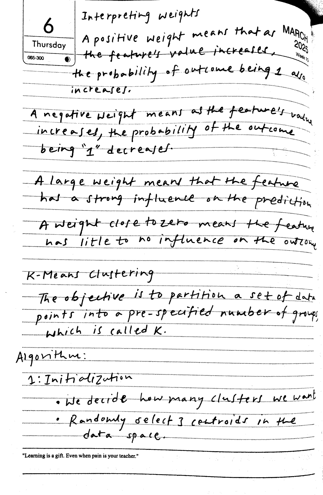

### Reference

Interpreting weights  

A positive weight means that as the feature's value increases, the probability of outcome being 1 also increases.  

A negative weight means as the feature's value increases, the probability of the outcome being "1" decreases.  

A large weight means that the feature has a strong influence on the prediction.  

A weight close to zero means the feature has little to no influence on the outcome.  

K-Means Clustering  
The objective is to partition a set of data points into a pre-specified number of groups, which is called K.  

Algorithm:  
1: Initialization  
• We decide how many clusters we want  
• Randomly select 3 centroids in the data space.  

Raw text and LaTeX

Interpreting weights  

A positive weight means that as the feature's value increases, the probability of outcome being 1 also increases.  

A negative weight means as the feature's value increases, the probability of the outcome being "1" decreases.  

A large weight means that the feature has a strong influence on the prediction.  

A weight close to zero means the feature has little to no influence on the outcome.  

K-Means Clustering  
The objective is to partition a set of data points into a pre-specified number of groups, which is called K.  

Algorithm:  
1: Initialization  
• We decide how many clusters we want  
• Randomly select 3 centroids in the data space.  

### 2200 px — 4.41 s; CER 28.2%

Interpreting weights  

A positive weight means that as the feature's value increases, the probability of outcome being 1 also increases.  

A negative weight means as the feature's value increases, the probability of the outcome being "1" decreases.  

A large weight means that the feature has a strong influence on the prediction.  

A weight close to zero means the feature has little to no influence on the outcome.  

1: Initialization  

• We decide how many clusters we want  

• Randomly select 3 centroids in the data space.  

"Learning is a gift. Even when pain is your teacher."  

Raw text and LaTeX

Interpreting weights  

A positive weight means that as the feature's value increases, the probability of outcome being 1 also increases.  

A negative weight means as the feature's value increases, the probability of the outcome being "1" decreases.  

A large weight means that the feature has a strong influence on the prediction.  

A weight close to zero means the feature has little to no influence on the outcome.  

1: Initialization  

• We decide how many clusters we want  

• Randomly select 3 centroids in the data space.  

"Learning is a gift. Even when pain is your teacher."  

### 1100 px — 2.46 s; CER 8.4%

Interpreting weights  

A positive weight means that as the feature's value increases, the probability of outcome being 1 also increases.  

A negative weight means as the feature's value increases, the probability of the outcome being "1" decreases.  

A large weight means that the feature has a strong influence on the prediction.  

A weight close to zero means the feature has little to no influence on the outcome.  

K-Means clustering  

The objective is to partition a set of data points into a pre-specified number of groups, which is called K.  

Algorithm:  

1: Initialization  

• We decide how many clusters we want  
• Randomly select 3 centroids in the data space.  

"Learning is a gift. Even when pain is your teacher."  

Raw text and LaTeX

Interpreting weights  

A positive weight means that as the feature's value increases, the probability of outcome being 1 also increases.  

A negative weight means as the feature's value increases, the probability of the outcome being "1" decreases.  

A large weight means that the feature has a strong influence on the prediction.  

A weight close to zero means the feature has little to no influence on the outcome.  

K-Means clustering  

The objective is to partition a set of data points into a pre-specified number of groups, which is called K.  

Algorithm:  

1: Initialization  

• We decide how many clusters we want  
• Randomly select 3 centroids in the data space.  

"Learning is a gift. Even when pain is your teacher."  

## messy-handwriting-2

### Original page

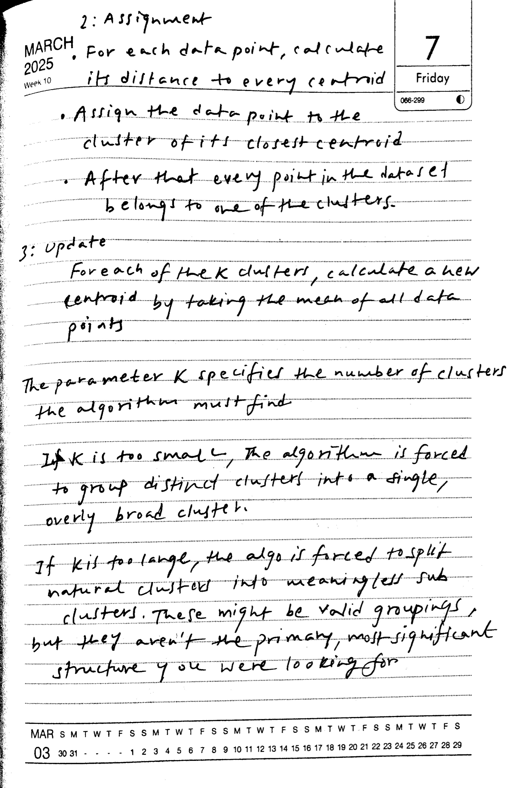

### Reference

2: Assignment  
• For each data point, calculate its distance to every centroid  
• Assign the data point to the cluster of its closest centroid  
• After that every point in the dataset belongs to one of the clusters.  

3: Update  
For each of the K clusters, calculate a new centroid by taking the mean of all data points  

The parameter K specifies the number of clusters the algorithm must find.  

If K is too small, the algorithm is forced to group distinct clusters into a single, overly broad cluster.  

If K is too large, the algo is forced to split natural clusters into meaningless sub clusters. These might be valid groupings, but they aren't the primary, most significant structure you were looking for.  

Raw text and LaTeX

2: Assignment  
• For each data point, calculate its distance to every centroid  
• Assign the data point to the cluster of its closest centroid  
• After that every point in the dataset belongs to one of the clusters.  

3: Update  
For each of the K clusters, calculate a new centroid by taking the mean of all data points  

The parameter K specifies the number of clusters the algorithm must find.  

If K is too small, the algorithm is forced to group distinct clusters into a single, overly broad cluster.  

If K is too large, the algo is forced to split natural clusters into meaningless sub clusters. These might be valid groupings, but they aren't the primary, most significant structure you were looking for.  

### 2200 px — 4.53 s; CER 37.8%

2: Assignment  

MARCH 2025  
Week 10  

For each data point, calculate its distance to every centroid  

• Assign the data point to the cluster of its closest centroid  
• After that every point in the dataset belongs to one of the clusters.  

3: Update  

For each of the K clusters, calculate a new centroid by taking the mean of all data points  

The parameter $K$ specifies the number of clusters.  

If $K$ is too large, the algorithm must find  

The parameter $K$ specifies the number of clusters.  

If $K$ is too large, the algorithm must find  

Raw text and LaTeX

2: Assignment  

MARCH 2025  
Week 10  

For each data point, calculate its distance to every centroid  

• Assign the data point to the cluster of its closest centroid  
• After that every point in the dataset belongs to one of the clusters.  

3: Update  

For each of the K clusters, calculate a new centroid by taking the mean of all data points  

The parameter $K$ specifies the number of clusters.  

If $K$ is too large, the algorithm must find  

The parameter $K$ specifies the number of clusters.  

If $K$ is too large, the algorithm must find  

### 1100 px — 2.44 s; CER 1.3%

2: Assignment  

For each data point, calculate its distance to every centroid  

• Assign the data point to the cluster of its closest centroid  
• After that every point in the dataset belongs to one of the clusters.  

3: Update  

For each of the K clusters, calculate a new centroid by taking the mean of all data points  

The parameter $K$ specifies the number of clusters the algorithm must find.  

If $K$ is too small, the algorithm is forced to group distinct clusters into a single, overly broad cluster.  

If $K$ is too large, the algo is forced to split natural clusters into meaningless subclusters. These might be valid groupings, but they aren't the primary, most significant structure you were looking for.  

Raw text and LaTeX

2: Assignment  

For each data point, calculate its distance to every centroid  

• Assign the data point to the cluster of its closest centroid  
• After that every point in the dataset belongs to one of the clusters.  

3: Update  

For each of the K clusters, calculate a new centroid by taking the mean of all data points  

The parameter $K$ specifies the number of clusters the algorithm must find.  

If $K$ is too small, the algorithm is forced to group distinct clusters into a single, overly broad cluster.  

If $K$ is too large, the algo is forced to split natural clusters into meaningless subclusters. These might be valid groupings, but they aren't the primary, most significant structure you were looking for.  

## neat-handwriting-1

### Original page

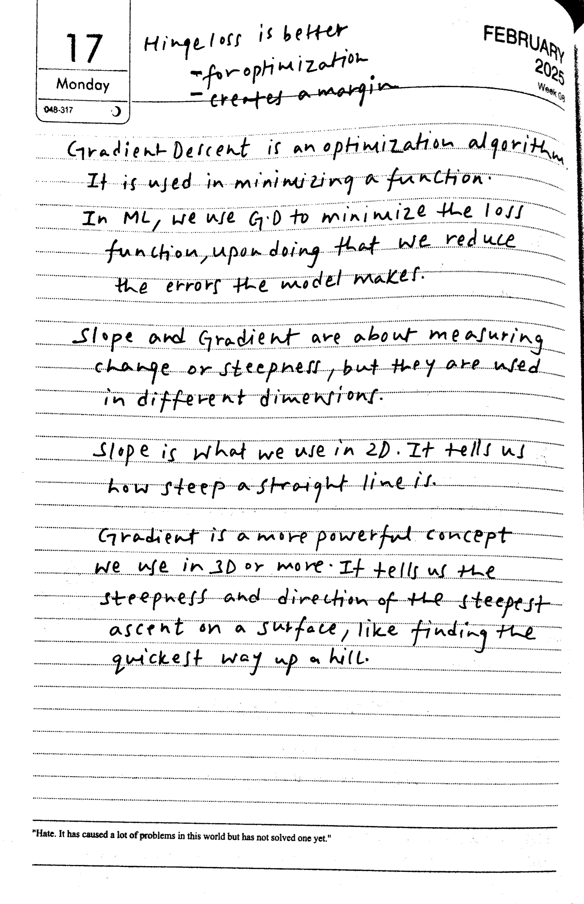

### Reference

Hinge loss is better  
- for optimization  
- creates a margin  

Gradient Descent is an optimization algorithm. It is used in minimizing a function.  
In ML, we use G.D to minimize the loss function, upon doing that we reduce the errors the model makes.  

Slope and Gradient are about measuring change or steepness, but they are used in different dimensions.  

Slope is what we use in 2D. It tells us how steep a straight line is.  

Gradient is a more powerful concept we use in 3D or more. It tells us the steepness and direction of the steepest ascent on a surface, like finding the quickest way up a hill.  

Raw text and LaTeX

Hinge loss is better  
- for optimization  
- creates a margin  

Gradient Descent is an optimization algorithm. It is used in minimizing a function.  
In ML, we use G.D to minimize the loss function, upon doing that we reduce the errors the model makes.  

Slope and Gradient are about measuring change or steepness, but they are used in different dimensions.  

Slope is what we use in 2D. It tells us how steep a straight line is.  

Gradient is a more powerful concept we use in 3D or more. It tells us the steepness and direction of the steepest ascent on a surface, like finding the quickest way up a hill.  

### 2200 px — 4.42 s; CER 26.4%

Hingeloss is better for optimization creates a margin  

Gradient Descent is an optimization algorithm. It is used in minimizing a function.  

In ML, we use G.D to minimize the loss function, upon doing that we reduce the errors the model makes.  

Slope and Gradient are about measuring change or steepness, but they are used in different dimensions.  

Slope is what we use in 2D. It tells us change or steepness, but they are used in different dimensions.  

Hate. It has caused a lot of problems in this world but has not solved one yet."  

Raw text and LaTeX

Hingeloss is better for optimization creates a margin  

Gradient Descent is an optimization algorithm. It is used in minimizing a function.  

In ML, we use G.D to minimize the loss function, upon doing that we reduce the errors the model makes.  

Slope and Gradient are about measuring change or steepness, but they are used in different dimensions.  

Slope is what we use in 2D. It tells us change or steepness, but they are used in different dimensions.  

Hate. It has caused a lot of problems in this world but has not solved one yet."  

### 1100 px — 2.47 s; CER 14.6%

Hingeloss is better for optimization creates a margin  

Gradient Descent is an optimization algorithm. It is used in minimizing a function.  

In ML, we use G.D to minimize the loss function, upon doing that we reduce the errors the model makes.  

Slope and Gradient are about measuring change or steepness, but they are used in different dimensions.  

Slope is what we use in 2D. It tells us how steep a straight line is.  

Gradient is a more powerful concept we use in 3D or more. It tells us the steepness and direction of the steepest ascent on a surface, like finding the quickest way up a hill.  

"Hate. It has caused a lot of problems in this world but has not solved one yet."  

Raw text and LaTeX

Hingeloss is better for optimization creates a margin  

Gradient Descent is an optimization algorithm. It is used in minimizing a function.  

In ML, we use G.D to minimize the loss function, upon doing that we reduce the errors the model makes.  

Slope and Gradient are about measuring change or steepness, but they are used in different dimensions.  

Slope is what we use in 2D. It tells us how steep a straight line is.  

Gradient is a more powerful concept we use in 3D or more. It tells us the steepness and direction of the steepest ascent on a surface, like finding the quickest way up a hill.  

"Hate. It has caused a lot of problems in this world but has not solved one yet."  

